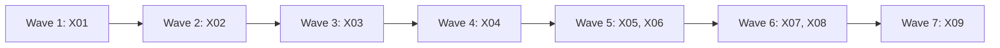

# Plan: the Codex agent runner

This plan builds steps c3 to c6 of [the connections proposal](connections-proposal.md) (section 8): agents that run on a Codex login. The connections plan (`docs/plan-connections-finish.md`, #290 to #367) is merged, and it moved this work here because three plan reviews kept finding design gaps in it. The section "Design" answers each of those gaps. The owner decided on 2 Nov 2026 (proposal decisions 2, 12 and 13, and `docs/agents-cli-findings.md`, "Decisions"): Pip stays on Claude, so c2 is skipped; Codex agents get no `--sandbox` flag, so the person's own Codex config decides what they can do; Codex is a beta provider with a Beta label, already offered in **+ Add** and Settings (#353). The first three PRs put a run backend trait between `runs/` and `claude`, with no change in behaviour. The next four build the Codex backend, and the last one lets the pickers choose Codex. Each entry is one small PR. A PR is done when its acceptance test passes in CI, an adversarial review reports no blockers or majors, and it is squash-merged.

## Goals this release serves

- **Work with the tools you already use**: "Claude Code (and Codex in beta)". Today a Codex login shows in Settings but can't run an agent. After X09 it can. Every entry serves this goal.
- **Agents take a ticket from plan to pull request**: a Codex agent is started, asked, answered, messaged, stopped and cleaned up by Pip and the person the same way a Claude agent is.
- Non-goals it comes close to:
  - **No sandbox or agent harness of its own.** Gossamr starts the person's own `codex` with their own config and passes no `--sandbox` flag. It does not commit or push for the agent, and it does not loosen the sandbox. Gossamr does supervise the process itself (it starts `codex exec`, keeps its pid and events, and stops it), because Codex has no background daemon that c0 checked. That is the same job the Claude daemon does for `claude --bg`. It is not a harness: the model, tools, sandbox and approvals stay Codex's.
  - **Pip stays locked down.** No entry changes Pip. Check C1 showed Codex can't be locked down to MCP tools, so `Driver::runs_pip` stays false for Codex.
  - **No writes to Jira without a draft.** No entry adds a write path. A Codex agent reports through the same four tools.

## Findings

Checked against `main` at 839ddbc3 on 3 Nov 2026, and against codex-cli 0.166.0-alpha.5.1 (the copy in ChatGPT.app on the owner's Mac, help and binary strings only; nothing was started).

| Finding | Where | What is wrong |
| --- | --- | --- |
| Every run action calls `claude` directly | `Toolchain.cli: Arc<dyn ClaudeCli>` (`runs/toolchain.rs:19`). 27 non-test calls: `service.rs:314,323,337,394,679`, `tracker.rs:248,406,440`, `final_answer.rs:58,69,78`, `answer.rs:100,105,188,204,207`, `message.rs:113`, `control.rs:295,369,406,439`, `cleanup.rs:69,83,165`, `continuation.rs:156`, `finder.rs:46`, `service/trust.rs:45`. `Failure::from_cli` takes a `Toolchain` (`failure.rs:99`). | A second backend would need a driver branch at each call. `launcher.rs` is only the `RunLauncher` trait (10 lines); the launch itself is `RunService::spawn` (`service.rs:350-408`). |
| A run's session is a Claude short id | `Run.short_id`, `Run.session_id` (`domain/run.rs:487-488`). "Has a session" is `short_id.is_some()` in Rust (`control.rs:44,50`, `cleanup.rs:28`, `tracker.rs:242,398`, `service.rs:464`) and `!!run.shortId` in the page (`RunSheet.tsx:113,130`, `AgentParts.tsx:58`, `cleanupLogic.ts:12`, `failureHelp.ts:88`, `runInstance.ts:13`, `NeedsPane.tsx:280,292,297`, `needs.ts:437`). | A Codex thread id is a UUID, and a Codex run also needs a pid. A run with no short id reads as never started everywhere. |
| Short ids are unique across the whole table, runs are matched per instance | `CREATE UNIQUE INDEX runs_short ON runs(short_id) WHERE short_id IS NOT NULL` (`db/schema.rs:449`). `RunIndex` entries carry `instance_id` (`index.rs:17-29`), and `belongs_to` checks it first (`service.rs:103-115`). | A Codex run's id has to fit this index and the `(instance, short id)` key. |
| The launch request carries the path of Claude's MCP file | `LaunchRequest.agent: Option<AgentLaunch>` (`cli.rs:168`), `AgentLaunch { config: PathBuf }` with a hand-written `Debug` (`agent_config.rs:14-23`), written by `offer_tools` (`offer.rs:25-45`). | Codex takes the server with `-c` keys and the token from an environment variable, not from a file. |
| A held `ask` call outlasts Codex's tool timeout | `ask` waits `ASK_WAIT`, 9 minutes (`runs/ask.rs:13`). Claude's file sets `"timeout": AGENT_CALL_TIMEOUT_MS`, 600 000 (`agent_config.rs:61`, `domain/run.rs:29`). Codex's per-server key is `tool_timeout_sec` (in the 0.166 binary's strings and in `codex-rs/codex-mcp/src/connection_manager.rs`), default 300 s on current `main`. | Without the key Codex cuts every `ask` that waits more than 5 minutes. |
| A timed-out `ask` ends a Codex turn as done | After `ASK_WAIT` the call returns `NO_ANSWER`, "End your turn now with your question" (`agent/agent_tools.rs:36,120`). Claude then lists the session `blocked`, which reads as Needs answer (`state.rs`). `codex exec` has no such state: it writes `turn.completed` and exits. | The run would read Done while it waits for an answer. Gossamr knows the question (`Asks`, `runs/ask.rs`), the event stream does not. |
| Codex hands the environment to the agent's commands | `shell_environment_policy.ignore_default_excludes` defaults to true, so `*TOKEN*` variables are not filtered (`codex-rs/config/src/shell_environment_policy.rs`). | `GOSSAMR_MCP_TOKEN` reaches the commands a Codex agent runs. The Claude file is also readable by the agent, so the exposure is the same, but rule 2 must say it. |
| A run is stored whole as JSON, and the same JSON reaches the page | `serde_json::to_string(run)` into `data` (`db/runs.rs:44,167`); `read_run` reads only `data` (`db/runs.rs:52`). | A field kept from the page with `#[serde(skip)]` is also dropped from `data`, so a pid needs its own column. |
| Codex can't be chosen for agents | `SystemToolchain::build` always looks for `Driver::Claude` (`toolchain.rs:96`); `open` refuses a driver whose `runs_agents()` is false (`toolchain.rs:137`); `Driver::runs_agents` (`connections.rs:57-59`); `DRIVERS.codex.runsAgents: false` (`src/lib/models.ts:37`; the old plan called it `DRIVER_CAPABILITIES`). | This is the switch the last PR turns. |
| Under the person's own sandbox a Codex agent can't commit | c0 check C6: `workspace-write` fails at `git add` on `<clone>/.git/worktrees/<name>/index.lock`; only `danger-full-access` commits and pushes. `codex exec` defaults to approval policy `never` (`codex-rs/exec/src/lib.rs`), so a blocked command fails and nothing asks. | A person with the usual setup gets an agent that edits files and then can't commit. The run has to say so. |
| The UI says Codex can't run | `providerLogic.ts:63`, `connectionsLogic.ts:48`, `modelPicker.ts:21`, `model_choice.rs:221-222`, `README.md:34`; `Settings.tsx:17` says "with its own Claude Code settings". | Copy for after X09. |
| Failure help assumes Claude | `failureHelp.ts` `claudeMissing` ("Agents are Claude Code sessions") and `notSignedIn` ("Type /login"); `Failure::ClaudeMissing` text (`failure.rs:39`); `providersNeedingSignIn` keeps `driver === "claude"` only (`connectionsLogic.ts:161`). | A Codex run that fails would get Claude's instructions. |
| The installed Codex is newer than c0's | codex-cli 0.166.0-alpha.5.1 lists `codex agents` ("agent sessions on the shared local app-server daemon"), `codex queue --thread <id> --message <text> [--resume]` and `exec --worktree`. c0 used 0.165.0-alpha.1.2. | Not checked by c0. This plan builds on the `exec` path c0 checked (see Flagged concerns). |

## Scope

In:

| Group | Entries | Size |
| --- | --- | --- |
| Run backend trait (c3) | X01, X02, X03 | M each |
| Codex launch and supervision (c4) | X04, X05 | M each |
| Codex answer, resume, stop, attach and clean-up (c5) | X07 | M |
| Rules and findings | X06 | S |
| Codex failure help, flags flipped, UI and README (c6) | X08, X09 | S, M |

Not in:

| Item | Why it waits |
| --- | --- |
| c2, Pip on Codex | Owner decision, 2 Nov 2026. Codex keeps built-in tools no flag removes (C1), which breaks rule 3. |
| A `--sandbox` flag, or Gossamr committing for a Codex agent | Owner decision, 2 Nov 2026 (decision 12). The run reports when the sandbox stops git (X05). |
| `codex agents`, `codex queue` and `exec --worktree` (0.166) | Not checked by c0. See Flagged concerns. |
| Reading what the person typed in a Codex session opened in Terminal | The Terminal session writes Codex's own rollout files, not `-o`. The run keeps the answer of its last `exec`. |
| Effort for Codex agents | Agents pass no effort (proposal 6.6). |
| Two runs sharing one Codex thread, or a Codex continuation picker | Codex has no listing to find another session in. |

## Design

These answer the gaps the three reviews of C01 to C05 found (`git show ed1052f1:docs/plan-connections-finish.md`), one by one. Entries refer to them by letter.

**(a) One trait above `ClaudeCli`, and one session handle.** `runs/backend.rs` defines `RunBackend` and `Session`. `Toolchain` holds `backend: Arc<dyn RunBackend>` in place of `cli`. `ClaudeCli` stays the command-line wrapper, used only inside `runs/backend/claude.rs`, by the two constructors in `toolchain.rs` that build a `ClaudeBackend`, and by tests. `Toolchain::new(cli, env)` keeps its signature for tests and wraps the `ClaudeCli` in a `ClaudeBackend`, so `rig.rs`, `FixedToolchain` and `FakeCli` keep working.

```rust
pub struct Session {
    /// Claude's own 8-hex id, or one Gossamr minted for a Codex run (see i).
    pub short_id: ShortId,
    /// Claude's session UUID, or the Codex thread id.
    pub session_id: Option<String>,
    /// The `codex` process of the current turn. Claude's daemon owns its processes, so it is none there.
    pub process: Option<RunProcess>,
}
```

`Session::of(&Run)` and `Session::of_entry(&index::Entry)` build it. The trait's methods take a `&Session` (or a `&Run` where they need its paths), never a bare `ShortId`, and the service never looks inside one. The calls move in three PRs: launch and preflight (X01), observe, find and final answer (X02), and every action on a session (X03). After X03, `grep` for `tc.cli` or `ClaudeCli` outside `runs/cli.rs`, `runs/backend/claude.rs`, `toolchain.rs` and the test files finds nothing, and the files that act on runs (`service.rs`, `tracker.rs`, `answer.rs`, `message.rs`, `control.rs`, `cleanup.rs`, `continuation.rs`, `final_answer.rs`, `finder.rs`, `offer.rs`) name no `Driver`, except the sign-in table in `control.rs:207-214`. Only `toolchain.rs` picks a backend by driver. A backend states what it can do with plain methods (`listed_sessions` returns none, `resumes_with_tools` returns false), never with its driver.

**(b) The tools offer is `{run_id, url, token}`.** `LaunchRequest.tools: Option<ToolsOffer>` replaces `agent: Option<AgentLaunch>`. `ToolsOffer` has a hand-written `Debug` that prints the run id and the URL and never the token, and a test checks `format!("{offer:?}")` and `format!("{request:?}")` against the token's hex. `offer_tools` mints the token and returns the offer; it no longer writes a file. The Claude backend writes its 0600 file in the 0700 `<data dir>/agents/` folder (the code in `AgentChannel::write_config`, moved, with the same path rules) and passes its path to `claude` as today. The Codex backend passes the URL with `-c` and the token in the child's environment (h).

**(c) A held `ask` survives on Codex.** Every Codex turn passes `-c mcp_servers.gossamr.tool_timeout_sec=600`, made from `AGENT_CALL_TIMEOUT_MS / 1000`, so the existing test `AGENT_CALL_TIMEOUT_MS > ASK_WAIT` (`domain/run.rs:1089`) covers both CLIs. The key name is confirmed: it is in the 0.166 binary and in Codex's source (`McpServerConfig.tool_timeout_sec`, seconds). Its default, 300 s, is below `ASK_WAIT`. X06 records this in the findings.

**(d) Needs answer comes from `Asks`, passed in.** `Asks` (`runs/ask.rs`) also keeps the question of an `ask` call that timed out unanswered, until the run is answered, cancelled, forgotten or asks again (`Asks::unanswered`). The tracker passes `Watched { run, misses, idle, ask }` to `observe`, where `ask` is `Held(question)`, `TimedOut(question)` or `None`, read from `core.asks()`. The Codex backend reads Needs answer from it: a live process with a held ask, or a turn that completed after an unanswered one. `runs/codex/` never imports `Core`. The Claude backend ignores `ask`, because Claude lists such a session as `blocked`. The tracker's `with_pending_ask` (`tracker.rs:413-425`) and the `asking` flag (`tracker.rs:486`) stay as they are for both.

**(e) The run folder.** A Codex run has `<data dir>/agents/runs/<run id>/`, mode 0700, with the run id checked by `plain_id` (`agent_config.rs:32`). It holds `events-<n>.jsonl` (stdout of turn n), `stderr-<n>.log`, `final.txt` (`-o`, the last answer, which can quote ticket text), `exit-<n>` (the exit code, written by the reaper task) and `terminal` (set by attach). Files are created 0600 with `create_new`. The folder is made by the Codex launch (X04) and removed by `forget_tools` when the worktree goes, and by `sweep_agent_files` on the same rule as the MCP files: the run is gone or failed, has no worktree, or ended more than six hours ago (`offer.rs:66-89`). A later resume makes it again. X04 builds both halves, so no release creates folders that nothing removes.

**(f) The pid.** `RunProcess { pid, started }` (`started` is the process start time in seconds from `proc_pidinfo(PROC_PIDTBSDINFO)`, so a reused pid is told apart). It is `Run.process`, `#[serde(skip)]`, so it is neither in the page's `Run` nor in `data`. One appended `APP_STEPS` step adds `runs.process TEXT` (JSON), written by `insert`/`save_run` and read back in `read_run` (`db/runs.rs`). `RunIndex`'s `Entry` gets `process: Option<RunProcess>` (`#[serde(default)]`), so `stop_all` can stop a Codex run of any account. `src/types.ts` does not change.

**(g) The backend comes from the driver, and the gate stays until X09.** `SystemToolchain::build` takes the instance's driver: it finds that driver's binary (`find_binary(driver, ..)`) and builds a `ClaudeBackend` or a `CodexBackend`. `open` keeps refusing a driver whose `runs_agents()` is false (`toolchain.rs:137`), so no Codex run can start, and no picker offers Codex for agents, until X09 flips `Driver::runs_agents` and `DRIVERS.codex.runsAgents` together. Until then the Codex backend is reached only by tests that call it directly.

**(h) The token travels in `GOSSAMR_MCP_TOKEN`.** The Codex child gets `-c mcp_servers.gossamr.bearer_token_env_var="GOSSAMR_MCP_TOKEN"` and the token in that variable of its own environment, set after `RunEnv::apply` (which clears the environment first). Never in argv, a script or a file. Pip already uses the same variable name (`claude/mod.rs:57`). Each Codex turn (launch and every resume) gets a fresh token from `offer_tools`; all of a run's tokens stay valid for that run only, as today. Codex passes the environment on to the agent's shell commands (Findings), so the token is visible to the agent and to what it runs, as Claude's 0600 file is. It reaches only this run's four tools and stops working when the run ends. X06 writes this into rule 2.

**(i) A Codex run's short id.** The service mints an 8-hex `ShortId` for every launch (`LaunchRequest.fresh_id`, made with `repo::random_hex` and checked against `RunIndex` and the `runs` table). The Claude backend ignores it, because Claude names its own sessions. The Codex backend uses it as the run's `short_id`, which Gossamr never passes to `codex`. The thread id goes in `session_id`. So a Codex run fits the global `runs_short` index (a minted id is checked unused first), is keyed `(instance, short id)` in `RunIndex` like any run, and every "has a session" check in Rust and in the page works unchanged. The uniqueness check reads the whole `runs` table on purpose, because the index covers the whole table; it is the one query that bypasses `Db`'s connection scope, and it reads only `short_id`.

**(j) Attach stops the `exec`, then opens `codex resume`.** `RunBackend::prepare_attach(&Session) -> CliResult<bool>` says whether it stopped the run. For Claude it does nothing and returns false. For Codex it stops the turn (SIGINT, then SIGKILL after `stop_wait`), writes the `terminal` marker and returns true; the service then cancels a held ask and marks the run stopped ("Opened in Terminal") and opens Terminal on `RunBackend::attach_words`: `attach <short id>` for Claude, `resume <thread uuid>` for Codex, after `cd` into the worktree and the instance's login lines. The script holds no token, so that Terminal session has no Gossamr tools. While a `codex` process with the thread id in its arguments is alive (found with `ps -axo pid=,args=`, matched as a whole word), the run reads Working, and a message or answer is refused with the existing `IN_TERMINAL` words (`message.rs:32`), so Gossamr never starts a second writer on the thread. When it exits, the run reads Done and keeps the answer of its last `exec`; the sheet's detail says "Carried on in Terminal".

**(k) What a Codex agent can do under the person's own config.** Gossamr passes no `--sandbox` and no approval flag. `codex exec` uses approval `never`, so nothing asks: a command the sandbox blocks fails, and the agent sees the failure. With `sandbox_mode` unset, or `read-only` or `workspace-write`, the agent can read and (with `workspace-write`) edit files in its worktree, and it can't commit or push: git needs `<clone>/.git/worktrees/<name>/`, which is outside the worktree (C6). With `danger-full-access` (in `config.toml` or a profile) it commits and pushes with the person's own git and `gh` credentials, as a Claude agent does. How the run reports it: the Codex guard adds one sentence, "If your sandbox stops git from committing or pushing, stop and say so in your report.", so the report says it; and the Codex backend sets the observation's detail to a fixed sentence when a `command_execution` item failed with one of the two messages C6 recorded (`index.lock': Operation not permitted`, `unable to create temporary object directory`): "Codex's sandbox kept git from committing here. Only danger-full-access commits and pushes from a worktree." The Codex row's detail and the **+ Add** line say the same before anyone starts an agent (X09).

## Order and waves



Seven waves, mostly a chain. X01 to X03 each add methods to `runs/backend.rs` and `runs/backend/claude.rs`, and X01 and X02 both edit `service.rs`, so they go one per wave. X04 builds on the full trait. X05 and X07 both edit `runs/codex/mod.rs` and the fake `codex`, so they are in different waves. X06 (docs only) and X08 (front end only) share no file with the entry beside them. X06 waits for X04, because the rules it writes are only true once a Codex launch passes the token in the environment. X09 turns Codex on, so it comes last, after the failure help (X08) and every Codex action (X07).

## Rules for every PR

- AGENTS.md holds: secrets only in the Keychain and never logged (rule 2); Pip has only Gossamr's MCP tools (rule 3); agents get Gossamr's MCP server, a short guard and the model, and no restricting flag, and Codex agents no `--sandbox` (rule 4); ticket text is data (rule 5). Every Tauri command is registered and mirrored in `src/backend/types.ts`, `jira.ts` and the mock; camelCase serde matches TypeScript; a schema change is a new step at the end of `APP_STEPS`; few comments; test names are behaviour sentences.
- Checks: `pnpm install --frozen-lockfile`, `pnpm typecheck`, `pnpm test`, `pnpm build`, then `mkdir -p dist && cd src-tauri && cargo clippy --all-targets -- -D warnings && cargo test`. Never run `#[ignore]` tests. e2e: `E2E_PORT=<port> pnpm e2e <spec>`; CI runs the full suite in 4 shards.
- Tests never touch the person's real `~/.claude.json`, `~/.claude-personal`, `~/.codex` or Keychain, and never start the real `codex`. Use temp folders and the fake CLIs in `src-tauri/test-support/`: `fake-claude.sh`, and `fake-codex.sh` from X04. A test that starts a fake `codex` process waits for it to exit or kills it before it returns.
- X01 to X03 change no behaviour: the existing runs tests pass with no edit but type and constructor names.
- Each PR adds a regression test that fails when the change is removed. The PR description says how that was checked.
- Each negative test checks that its input really contains what the check looks for (a test that the token is not in argv first checks that the token was minted and is in the child's environment).
- New e2e tests go in new files. Named exception: X09 edits `e2e/providers.spec.ts`, whose three assertions say Codex can't run.
- After merging `main` into a branch, rerun clippy and the tests locally: two PRs can each pass CI and still break main together.
- This repo has no CHANGELOG. `docs/plan-*.md`, `AGENTS.md`, `Cargo.toml` and lockfiles are gated paths: the maintainer merges those PRs.

## PRs

### Wave 1

**X01 A run backend trait: launch and preflight (c3, part 1).** Touches: new `src-tauri/src/runs/backend.rs`, new `src-tauri/src/runs/backend/claude.rs`, new `src-tauri/src/runs/backend/tests.rs`, `src-tauri/src/runs/mod.rs`, `src-tauri/src/runs/toolchain.rs`, `src-tauri/src/runs/cli.rs`, `src-tauri/src/runs/agent_config.rs`, `src-tauri/src/runs/offer.rs`, `src-tauri/src/runs/service.rs`, `src-tauri/src/runs/failure.rs`, `src-tauri/src/runs/rig.rs`, `src-tauri/src/runs/service/tests.rs`, `src-tauri/src/runs/offer/tests.rs`.
- `runs/backend.rs`: `Session`, `RunProcess` (fields only; X04 fills it), `ToolsOffer`, the backend-level `LaunchRequest` (`cwd`, `name`, `worktree`, `guard`, `prompt`, `tools`, `model`, `fresh_id`) and the `RunBackend` trait with `preflight(&self, clone: &Path) -> Result<(), Failure>`, `launch(&self, &LaunchRequest) -> CliResult<Session>` and `binary()`. `Session::of(&Run)` builds the handle from `short_id`, `session_id` (and, from X04, `process`).
- `runs/backend/claude.rs`: `ClaudeBackend { cli: Arc<dyn ClaudeCli>, env: Arc<RunEnv>, files: PathBuf }`. `preflight` is the body of `RunService::check` from `auth_status` on (`service.rs:314-326`: signed in, the trust check, `--bg`); the checks before it (spec, work folder, cap, clone, origin) stay in `check`, which then calls `tc.backend.preflight(clone)`. `launch` writes the 0600 MCP file from the offer (b) and calls `ClaudeCli::launch` with its path, so the cli-level request in `cli.rs` keeps `agent: Option<AgentLaunch>` and the rule 4 tests in `cli.rs` (`launch_runs_in_the_clone_with_the_exact_flags_and_nothing_else_in_the_environment`, `offering_the_tools_adds_a_config_path_and_one_allow_rule_for_each_and_never_the_token`) stay as they are.
- `Toolchain` gains `backend: Arc<dyn RunBackend>`; `SystemToolchain::build` wraps the `SystemCli` in a `ClaudeBackend` whose `files` is `<data dir>/agents`, and `Toolchain::new(cli, env)` does the same with a folder the test sets (`rig.rs` `reporting` passes its channel's folder). `cli` stays one more PR, for the call sites X02 and X03 move.
- `offer_tools` (`offer.rs:25-45`) returns `Option<ToolsOffer>` after `report_reserve`. `AgentChannel` keeps `url_for`, `remove_config` and `configured`; `write_config` becomes the Claude backend's file writer.
- `RunService::spawn` (`service.rs:378-394`) builds the backend-level request, mints `fresh_id` (i: `random_hex(8)`, tried again while `RunIndex` or the `runs` table has it; the table check is a new `Db::short_id_in_use`, which reads the whole table on purpose), and stores the returned `Session`'s `short_id` and `session_id`. `Failure::from_cli` (`failure.rs:99`) takes the instance name and folder flag instead of a `Toolchain`.
- No behaviour change.
Regression test: in `backend/tests.rs`, `the_tools_offer_never_prints_its_token` (`ToolsOffer` and `LaunchRequest` `Debug` against the token's hex, after checking the token is 52 characters and `gsr_`-prefixed); `the_claude_backend_writes_a_private_mcp_file_from_the_offer_and_passes_only_its_path` (mode 0600 in a 0700 folder, URL and `Authorization` header in the file, path in the `FakeCli` launch, token in no argument); `a_fake_backend_gets_the_launch_and_the_preflight_of_a_run_on_its_instance` (a `RunBackend` test double in a `FixedToolchain`, run through `start_now`). The last fails on main, where `spawn` calls `ClaudeCli` and no backend exists; the first two fail if the offer derives `Debug` or the file is written elsewhere.
Acceptance: `mkdir -p dist && cd src-tauri && cargo test runs::` passes, and from the repo root `git diff origin/main -- src-tauri/src/runs/service/tests.rs src-tauri/src/runs/tracker/tests.rs src-tauri/src/runs/cli.rs` shows no changed assertion.

### Wave 2

**X02 Observe, find and the final answer through the trait (c3, part 2).** Touches: `src-tauri/src/runs/backend.rs`, `src-tauri/src/runs/backend/claude.rs`, `src-tauri/src/runs/backend/tests.rs`, `src-tauri/src/runs/tracker.rs`, `src-tauri/src/runs/final_answer.rs`, `src-tauri/src/runs/service.rs`, `src-tauri/src/runs/tracker/tests.rs`, `src-tauri/src/runs/service/tests.rs`.
- The trait gains `observe(&self, watched: &[Watched], dirs: &Folders, now) -> CliResult<Observations>`, `find(&self, run: &Run, dirs: &Folders) -> CliResult<Option<Session>>`, `final_answer(&self, run: &Run, dirs: &Folders) -> Option<String>` and `listed_sessions(&self) -> CliResult<Vec<AgentEntry>>` (default: none).
- `Watched { run, misses, idle, ask }` with `ask: AskState { None, Held(String), TimedOut(String) }` (d). X02 fills `Held` from `core.asks().question`; `TimedOut` stays `None` until X05.
- `Observation { run_id, seen: state::Observed, session: Option<Session>, tokens, detail, branch, progress_at, suggested_reply, timeline: Vec<TimelineLine>, answer: Option<String>, revived: bool }`; `Observations { runs, sessions: Vec<AgentEntry> }`. The Claude backend makes them from its one `claude agents --json --all`, `job` and `map_state`: the code now in `track` from `tracker.rs:433-445` and `461-470`, `revived` (`tracker.rs:81-96`) and `read_answer` (`final_answer.rs:66-79`) move there. `track` applies an `Observation` the same way it applies `entry` and `job` today, and `adopt_continuations` reads `Observations.sessions`, so a backend with no listing gets no continuations without a branch.
- `Folders { config_dir, projects_dir }`: the service's two per-instance maps (`service.rs:90-92`) become one `Mutex<HashMap<String, Folders>>`, filled once per instance from a new trait method `folders(&self) -> Folders` (Claude: from `auth status`, as `claude_config_dir` and `claude_projects_dir` do now, `tracker.rs:402-409`, `final_answer.rs:54-62`). A backend with no such folders returns empty ones.
- `RunService::find_session` (`service.rs:331-346`) and `recover` (`service.rs:653-702`) call `find` per instance instead of `agents` and `belongs_to`; `belongs_to` moves into the Claude backend and stays `pub(super)` for its tests.
- No behaviour change.
Regression test: `the_tracker_applies_what_a_backend_observes_whatever_backend_it_is` (a test double that reports Working, then Needs answer with a question, then Done with an answer, for a run on its instance; the run, its events and the notices follow); `recovery_adopts_the_session_a_backend_finds_and_fails_the_rest` (test double). Both fail on main, where the tracker reads `claude agents` only. The existing tracker and service tests pass unchanged.
Acceptance: `mkdir -p dist && cd src-tauri && cargo test runs::` passes, and from the repo root `git diff origin/main -- src-tauri/src/runs/tracker/tests.rs src-tauri/src/runs/service/tests.rs` adds tests and changes no existing assertion.

### Wave 3

**X03 Every action on a session through the trait (c3, part 3).** Touches: `src-tauri/src/runs/backend.rs`, `src-tauri/src/runs/backend/claude.rs`, `src-tauri/src/runs/backend/tests.rs`, `src-tauri/src/runs/toolchain.rs`, `src-tauri/src/runs/answer.rs`, `src-tauri/src/runs/message.rs`, `src-tauri/src/runs/control.rs`, `src-tauri/src/runs/cleanup.rs`, `src-tauri/src/runs/continuation.rs`, `src-tauri/src/runs/finder.rs`, `src-tauri/src/runs/service/trust.rs`, `src-tauri/src/runs/answer/tests.rs`, `src-tauri/src/runs/message/tests.rs`, `src-tauri/src/runs/control/tests.rs`, `src-tauri/src/runs/cleanup/tests.rs`.
- The trait gains: `auth()`; `ready_for_answer(&Session, &Run)` (Claude: listed `blocked` with no `waitingFor`, `answer.rs:100-101`); `open_elsewhere(&Session, &Run)` (Claude: the `attached` check, `message.rs:113-121`); `stop(&Session)`; `resume(&Session, &ResumeRequest, &Waits) -> Result<Resumed, String>` with `Resumed::Same(Session)` or `Resumed::Copy(ShortId)` (Claude: the wait-until-at-rest loop, settle and `--bg --resume` of `wake_from`, `answer.rs:185-214`; `ResumeRequest { message, cwd, tools }`); `resumes_with_tools()` (Claude: false, since any flag on a resume starts a copy); `remove(&Run, leftovers) -> CliResult<RemoveOutcome>` (Claude: `live_sessions`, stop, `remove_session` with its lock retries, `cleanup.rs:68-94,162-181`); `prepare_attach(&Session)` (Claude: nothing) and `attach_words(&Session) -> Vec<String>` (Claude: `attach <id>`); `terminal_words(Purpose) -> Option<Vec<String>>` (Claude: today's `claude` plus flags, `control.rs:153-160`); `scratch_dir(&Session, &Folders)` (Claude: `jobs/<id>`, `control.rs:447-454`).
- `answer`, `message_agent`/`resume_with`/`another_pass`, `stop_as`, `stop_all` (each index entry through `Session::of_entry`), `attach`, `open_claude`, `disk`, `cleanup`, `adopt_session` (through `listed_sessions`), `unready` (`finder.rs:39-51`) and `retry_with_trust` (`service/trust.rs:45`, through `auth`) use only the backend. `write_attach_file` and `write_claude_file` take the binary and the backend's words; every word must be letters, digits and `-` (a short id or a UUID or a fixed flag), checked where the script is written.
- `Toolchain.cli` goes. `ClaudeCli` is used only in `runs/cli.rs`, `runs/backend/claude.rs`, the two places in `toolchain.rs` that build a `ClaudeBackend` (`Toolchain::new`, `SystemToolchain::build`) and the test files. The `toolchain.rs` tests that read a login's variables through `tc.cli.version()` (`toolchain.rs:227,237,281`) read them through a test-only `ClaudeBackend::cli()`.
- `attach` calls `prepare_attach` first; when it returns true, the service cancels a held ask, marks the run stopped with the detail "Opened in Terminal" and stores it, under the launch lock, before it opens Terminal (j). The Claude backend always returns false, so Claude's attach is unchanged.
- `Waits` carries `stop_wait`, `poll` and `stop_settle` from `Timing` (`service.rs:36-50`), so test timings keep reaching the Claude wait loop.
- No behaviour change.
Regression test: `every_action_on_a_run_reaches_its_own_backend` (a test double records stop, ready_for_answer, resume, open_elsewhere, remove, prepare_attach, attach_words, scratch_dir for a run on its instance, through `stop`, `answer`, `message_agent`, `attach`, `disk` and `cleanup`); `an_attach_word_with_a_quote_or_a_space_is_refused_before_a_script_is_written`. Both fail on main, where these call `ClaudeCli`. The existing answer, message, control and cleanup tests pass unchanged.
Acceptance: `mkdir -p dist && cd src-tauri && cargo test runs::` passes, and from the repo root `grep -rnE "tc\.cli|ClaudeCli" src-tauri/src/runs | grep -vE "runs/(cli|testing|real_tests|rig|toolchain)\.rs|backend/claude\.rs|/tests"` prints nothing.

### Wave 4

**X04 Codex launch: the worktree, the process, the run folder and the pid (c4, part 1).** Touches: new `src-tauri/src/runs/codex/mod.rs`, new `src-tauri/src/runs/codex/launch.rs`, new `src-tauri/src/runs/codex/process.rs`, new `src-tauri/src/runs/codex/tests.rs`, new `src-tauri/test-support/fake-codex.sh`, `src-tauri/src/runs/mod.rs`, `src-tauri/src/runs/backend.rs`, `src-tauri/src/runs/toolchain.rs`, `src-tauri/src/runs/index.rs`, `src-tauri/src/runs/repo.rs`, `src-tauri/src/runs/offer.rs`, `src-tauri/src/runs/failure.rs`, `src-tauri/src/runs/finder.rs`, `src-tauri/src/runs/offer/tests.rs`, `src-tauri/src/runs/service/tests.rs`, `src-tauri/src/runs/service/choice/tests.rs`, `src-tauri/src/domain/run.rs`, `src-tauri/src/db/schema.rs`, `src-tauri/src/db/runs.rs`, `src-tauri/src/provider_probe.rs`, `src-tauri/Cargo.toml`, `src-tauri/Cargo.lock`.
- `CodexBackend { binary, login_env, git_env, runs_root, home }` (`runs_root` is `<data dir>/agents/runs`). `preflight`: the clone check is shared; signed in comes from `codex login status` through `provider_probe`'s Codex parser (`codex_account`, `provider_probe.rs:180`, made `pub(crate)`); not signed in is `Failure::NotSignedIn`; Codex has no trust step and no `--bg` check.
- `launch`: makes the run folder (e). Makes the worktree at `spec.worktree()` (`domain/run.rs:248-250`, the same path Claude uses, so the `runs_worktree` index, the containment checks and the attach script need no second rule) on branch `worktree-<name>` from `origin/<spec.base>`, with a new `Git::add_worktree` (refuses an existing path or branch). Then spawns, with stdin closed, stdout to `events-1.jsonl`, stderr to `stderr-1.log`, in a new session (`setsid` in `pre_exec`, through the `libc` crate, a new direct dependency), never `kill_on_drop`:
  `codex exec --json -C <worktree> -o <run folder>/final.txt [-m <model>] -c mcp_servers.gossamr.url="<url>" -c mcp_servers.gossamr.bearer_token_env_var="GOSSAMR_MCP_TOKEN" -c mcp_servers.gossamr.default_tools_approval_mode="approve" -c mcp_servers.gossamr.tool_timeout_sec=600 -c developer_instructions="<GUARD AGENT_GUARD CODEX_GUARD>" -- <prompt>`
  The `-c` values are TOML strings made by one `toml_string` that escapes `\`, `"` and control characters. With no offer, the four `mcp_servers.gossamr.*` keys are left out. No `--sandbox`, no approval flag, no `--ignore-user-config`, no `--skip-git-repo-check` (k, rule 4).
- `launch` returns a `Session` with `short_id = fresh_id`, `process = RunProcess { pid, started }` and `session_id` = the `thread_id` of the first `thread.started` line, read from `events-1.jsonl` for up to 60 s (the Claude launch limit, `cli.rs:22`). If none comes, or the process exits first, the launch fails with the last line of `stderr-1.log`, redacted. A reaper task waits on the child and writes `exit-1`, so a finished child never stays a zombie that `kill(pid, 0)` would call alive.
- `runs/codex/process.rs`: `alive(&RunProcess)` (`kill(pid, 0)` and the same `started`), `signal`, and `started_of(pid)`.
- `Run.process: Option<RunProcess>` with `#[serde(skip)]`; a new last `APP_STEPS` step `ALTER TABLE runs ADD COLUMN process TEXT;` (`db/schema.rs:534`); `insert`, `save_run` and `read_run` carry it (f). `index::Entry.process` (`#[serde(default)]`).
- `SystemToolchain::build` takes the driver and builds the matching backend (`toolchain.rs:93-102`); `open` keeps refusing Codex for agents (g). `ToolchainError::ClaudeMissing` and `Failure::ClaudeMissing` carry the driver (their constructors in `toolchain.rs:98`, `failure.rs:72,105` and `finder.rs:48`, and the tests that build them), so a missing `codex` says "`codex` isn't installed, or Gossamr can't find it for Codex work." (`RunFailure::ClaudeMissing` keeps its serialized name `claudeMissing`).
- `forget_tools` removes the run folder, and `sweep_agent_files` removes the folders of runs that may not keep one (e).
- `fake-codex.sh`, driven by `FAKE_CODEX_SCENARIO` (keys at the top, like `fake-claude.sh`): records cwd and argv to `calls.log` and the environment's names to `env.last`; writes `ok` to `token.seen` when `GOSSAMR_MCP_TOKEN` is set, never its value; for `exec` prints `thread.started` with a fixed UUID, item lines and `turn.completed` with usage, writes the `-o` file, and with `hold=<s>` stays alive, exiting 130 on SIGINT without `turn.completed`; `login status` prints the scenario's line to stderr.
Regression test: in `codex/tests.rs` with the fake: `a_codex_launch_makes_the_worktree_and_run_folder_and_records_the_thread_and_a_live_process` (0700 folder, 0600 files, `session_id` is the fake's UUID, `alive` true after `launch` returns, then the test kills it); `a_codex_launch_passes_the_server_the_approval_the_tool_timeout_and_the_guard_and_no_sandbox` (argv holds each `-c` key and `tool_timeout_sec=600`; holds none of `--sandbox`, `-s`, `--ignore-user-config`, `--dangerously-bypass-approvals-and-sandbox`, `approval_policy`, `sandbox_mode`); `the_mcp_token_is_in_the_codex_environment_and_in_no_argument` (checks `token.seen` and `GOSSAMR_MCP_TOKEN` in `env.last` first, then that no argument holds the token's hex); `a_reused_pid_is_not_the_run_s_process`; `a_codex_run_keeps_its_process_in_the_database_and_the_index_but_not_in_what_the_page_gets` (`serde_json::to_value(&run)` has no `process`; a stored and loaded run has it); `the_run_folder_goes_with_the_worktree_and_with_the_sweep`; in `toolchain.rs` tests, `build_gives_a_codex_instance_the_codex_backend` while `for_instance` still refuses it. All fail on main, where no Codex backend exists.
Acceptance: `mkdir -p dist && cd src-tauri && cargo test -- runs::codex runs::toolchain runs::offer db::` passes, and from the repo root `grep -nE "Driver::" src-tauri/src/runs/{service,tracker,answer,message,cleanup,continuation,final_answer,finder,offer}.rs` prints nothing.

### Wave 5

**X05 Codex supervision: state, needs answer, final answer and restart (c4, part 2).** Touches: new `src-tauri/src/runs/codex/events.rs`, new `src-tauri/src/runs/codex/observe.rs`, `src-tauri/src/runs/codex/mod.rs`, `src-tauri/src/runs/codex/tests.rs`, new `src-tauri/test-fixtures/codex/` (event streams), `src-tauri/test-support/fake-codex.sh`, `src-tauri/src/runs/ask.rs`, `src-tauri/src/runs/tracker.rs`, `src-tauri/src/runs/tracker/tests.rs`.
- `events.rs` reads the newest `events-<n>.jsonl` (the last 4 MB, like `TIMELINE_TAIL`, `cli.rs:24`; a partial first line dropped; bad lines skipped; a symlink not followed) into: the thread id, the last `turn.completed` or `turn.failed`/`error`, tokens summed from every turn's `usage`, the latest item for the detail (a command's text, "Calling <tool>", or the start of an agent message), timeline lines from completed items, and whether a `command_execution` failed with one of the C6 git messages (k). Only `thread.started`, `turn.*`, `item.*` and `error` are read; unknown types and fields are ignored.
- `observe` per watched run, in this order: a `codex` process with the thread id in its arguments other than the run's (the Terminal, j) gives Working and `revived`; the run's own process alive gives Working, or Needs answer with the question when `ask` is `Held`; Launching with no `thread.started` after `LAUNCH_WAIT` (`state.rs:12`) gives Failed; an exited turn with `turn.completed` gives Done (or Needs answer with the question when `ask` is `TimedOut`); an exited turn with `turn.failed` or `error` gives Failed with that message, redacted and cut; an exited turn with neither gives Failed with `PROCESS_ENDED` (`state.rs:27`), except a run already Stopped by Gossamr, which stays Stopped; a run with the `terminal` marker and no live process gives Done ("Carried on in Terminal"). The answer is `final.txt` (capped at 2 MB, no symlink), else the last `agent_message` item.
- `find` (recovery and Retry): reads `process` and the thread id back from the run folder after a launch whose answer was lost, so `recover` adopts a Codex run started just before a quit. A live, matching process after a restart is tracked again; the process survives a quit because it has its own session (C4).
- `Asks::unanswered` (d): `Waiting::until` (`ask.rs:121-133`) keeps the question when it times out; `answer`, `cancel`, `forget` and a new `open` clear it. The tracker passes `AskState::TimedOut` from it.
- `fake-codex.sh` gains `fail=<message>`, `exit_early=1`, `sandbox_git=1` (a failed `git add` item with C6's message) and `answer=<text>`.
Regression test: fixture streams for working, done, failed, ended early and sandbox-blocked map to their states and details; `a_codex_run_waiting_in_ask_reads_as_needs_answer_and_asking`; `a_codex_turn_that_ended_after_an_unanswered_ask_reads_as_needs_answer_not_done`; `a_codex_run_whose_sandbox_stopped_git_says_so`; `after_a_restart_a_live_codex_process_is_tracked_again_and_an_exited_one_is_read_from_its_events`; `a_finished_codex_run_takes_its_answer_from_the_o_file`; and in `ask.rs`, `an_ask_that_timed_out_keeps_its_question_until_the_run_is_answered`. All fail on main.
Acceptance: `mkdir -p dist && cd src-tauri && cargo test -- runs::codex runs::ask runs::tracker` passes.

**X06 Write down the Codex runner's rules and findings.** Touches: `AGENTS.md`, `docs/agents-cli-findings.md`, `docs/connections-proposal.md`.
- AGENTS.md rule 2: a Codex agent gets its per-run token in the `GOSSAMR_MCP_TOKEN` variable of its own `codex` process, never in argv, a script or a file; Codex passes its environment to the commands the agent runs, so the agent can read it, as it can read Claude's 0600 file; it reaches only that run's four tools and stops working when the run ends. Rule 4: Gossamr adds its MCP server (`-c mcp_servers.gossamr.*`), the guard (`developer_instructions`) and `-m` to a Codex agent, and no `--sandbox` or approval flag (tests in `src-tauri/src/runs/codex/tests.rs`); Codex's own sandbox setting decides what it can do, and only `danger-full-access` commits and pushes from Gossamr's worktree. Layout: the `runs/` row names `runs/backend/` and `runs/codex/` (`codex exec`). Read first: `docs/agents-cli-findings.md` covers `codex` too.
- Findings: a "Codex runner" section: the command line, `tool_timeout_sec` (key confirmed from the 0.166 binary and source, default 300 s), the run folder, the pid check, the event types read, SIGINT behaviour (C5), the token in the environment and `shell_environment_policy`, the sandbox messages, and an owner check to run once with a real login (launch, one `ask` held over 5 minutes, one answer, attach, clean-up), with the version and date to fill in. Also the 0.166 commands this plan does not use.
- Proposal: 8.2 says c3 to c6 are built by `docs/plan-codex-runner.md`, and 8.1's "Attach while running", "Resume" and "Message a running agent" rows point to it.
Regression test: none (docs only). The PR description lists each claim with the file and test that backs it.
Acceptance: `grep -n "GOSSAMR_MCP_TOKEN" AGENTS.md` and `grep -n "tool_timeout_sec" docs/agents-cli-findings.md` each find a line, and every test name the docs cite exists (`grep -rn "<name>" src-tauri/src`).

### Wave 6

**X07 Codex answer, message, stop, attach and clean-up (c5).** Touches: new `src-tauri/src/runs/codex/control.rs`, `src-tauri/src/runs/codex/mod.rs`, `src-tauri/src/runs/codex/tests.rs`, `src-tauri/test-support/fake-codex.sh`, `src-tauri/src/runs/cleanup.rs`, `src-tauri/src/runs/cleanup/tests.rs`.
- `stop`: SIGINT to the process when it is alive and still the run's, wait for `exit-<n>` or the process to go for up to `stop_wait`, then SIGKILL. A process that is already gone is stopped. `ready_for_answer`: the process is gone or was stopped. `open_elsewhere`: the Terminal check (j).
- `resume`: waits as `stop` does, then starts `codex exec resume <thread uuid> --json -o final.txt [the launch's `-m` and `-c` keys, with a fresh token] -- <reminder + message>` with the worktree as its working folder (`exec resume` takes no `-C`), stdout to `events-<n+1>.jsonl`, in its own session, with a reaper, and returns `Resumed::Same` with the new `RunProcess`. The thread id must be a UUID (`is_uuid`, `cli.rs:277`). `resumes_with_tools` is true. No `--sandbox` (C5 resumed without one). A resume that prints a different thread id is `Resumed::Copy`, stopped, and reported like a Claude copy.
- `prepare_attach` and `attach_words` (j). `scratch_dir` is the run folder.
- `remove`: stops a live process, removes the worktree and branch with git, then `codex delete --force <thread uuid>`. The git part is `remove_with_git` (`cleanup.rs:107-132`), made a free function both the removed-instance path and the Codex backend call, so it keeps refusing a clone or worktree outside `~/Gossamr/agents` and a branch that isn't merged or pushed (`check_branch_deletable`). A refused `codex delete` leaves the run cleaned and says "Codex kept its saved session: <stderr's last line, redacted>"; a refused git step keeps everything, in git's words.
- `fake-codex.sh` gains `exec resume` (appends a turn and answers with the message's last line), `delete --force` (records the id), and `refuse_delete=1`.
Regression test: with the fake, `an_answer_to_a_codex_run_resumes_the_same_thread_with_a_new_process_and_the_reminder`; `a_message_to_a_finished_codex_run_starts_another_pass`; `stopping_a_codex_run_leaves_no_process_and_reads_stopped_not_failed`; `stop_all_stops_a_codex_run_of_another_account_by_its_indexed_pid`; `attach_stops_the_codex_turn_then_opens_codex_resume_with_no_token_in_the_script`; `a_message_waits_while_the_thread_is_open_in_terminal`; `cleaning_up_a_codex_run_removes_its_worktree_branch_folder_and_saved_session`; `unpushed_codex_work_keeps_its_worktree_in_git_s_words`. All fail on main.
Acceptance: `mkdir -p dist && cd src-tauri && cargo test -- runs::codex runs::cleanup` passes, and from the repo root `grep -nE "Driver::" src-tauri/src/runs/{answer,message,control,cleanup}.rs` finds only the sign-in table in `control.rs` (`write_provider_signin`).

**X08 Failure help and sign-in words for Codex runs.** Touches: `src/workspace/providerLogic.ts`, `src/workspace/failureHelp.ts`, `src/workspace/connectionsLogic.ts`, `src/workspace/runInstance.ts`, `src/workspace/failureHelp.test.ts`, `src/workspace/connectionsLogic.test.ts`, `src/workspace/providerLogic.test.ts`.
- `RunInstance` (`providerLogic.ts:76-79`) gains `driver`. `failureHelp` uses it: `claudeMissing` on a Codex instance says "Codex isn't installed, or Gossamr can't find it for <name>.", "Agents on <name> are Codex sessions, so Gossamr needs the codex command. Install it, or the ChatGPT app, then retry." with a link to Codex's install page and no `curl` command; `notSignedIn` on Codex opens the instance's sign-in command (`codex login`, with its `CODEX_HOME`), never "Type /login". Claude's words stay as they are.
- `providersNeedingSignIn` (`connectionsLogic.ts:161`) counts a signed-out Codex login that a run or the "New agents use" default needs, so the banner names it.
Regression test: vitest: a Codex run that failed `claudeMissing` and one that failed `notSignedIn` get Codex's words and command; the Claude cases keep theirs; a signed-out Codex that "New agents use" names is in `providersNeedingSignIn`. Fail on main, where every run gets Claude's help and Codex is filtered out.
Acceptance: `pnpm test failureHelp connectionsLogic providerLogic` passes.
QA: in `pnpm dev`, set a mock run on a Codex instance to fail as not signed in and as not installed (the mock's run controls), and read the card, the sheet and the banner in light and dark.

### Wave 7

**X09 Agents run on Codex (c6).** Touches: `src-tauri/src/connections.rs`, `src-tauri/src/model_choice.rs`, `src-tauri/src/runs/toolchain.rs`, `src/lib/models.ts`, `src/lib/modelPicker.ts`, `src/lib/modelPicker.test.ts`, `src/workspace/providerLogic.ts`, `src/workspace/connectionsLogic.ts`, `src/workspace/Settings.tsx`, `src/workspace/Connections.test.tsx`, `src/workspace/Settings.test.ts`, `src/backend/mockRuns.ts`, `src/backend/mockRuns.test.ts`, `e2e/providers.spec.ts`, new `e2e/codex-agents.spec.ts`, `README.md`, `docs/connections-proposal.md`.
- `Driver::runs_agents` is true for Codex (`connections.rs:57-59`) and `DRIVERS.codex.runsAgents` is true (`models.ts:37`); `runs_pip` stays false. The test `codex_runs_neither_pip_nor_agents_until_its_runner_is_built` (`model_choice.rs:379`) becomes `codex_runs_agents_and_never_pip`. The Codex case of `an_instance_that_is_off_or_has_a_bad_folder_or_cannot_run_agents_is_unusable_and_says_which` (`toolchain.rs:263-271`) becomes a Codex instance that `for_instance` gives the Codex backend.
- `Reason::CantRun` for Pip says "Pip runs on Claude only." (proposal 7.1; `model_choice.rs:221`), and the picker's reason in `modelPicker.ts:21` says the same. The agents' words stay, but no driver reaches them any more.
- Copy, each with the Beta label kept: `usedForLine` for Codex (`providerLogic.ts:63`): "Codex is in beta. Agents run on Codex work with its own Codex settings: only danger-full-access lets them commit and push. Pip runs on Claude."; the + Add line (`connectionsLogic.ts:48`): "A login that agents can run on. Pip stays on Claude."; `agentsPromise` (`Settings.tsx:16-17`) names Codex settings for a Codex instance.
- The mock: a run on a Codex instance runs like any mock run, its sheet says "Runs on Codex work · Default", and its Open in Terminal records `codex resume`.
- README: Codex (beta) can run agents, what its sandbox setting means for commits (k), and that Pip stays on Claude. Proposal: 6.1's "After c6" becomes "Yes", the 10.1 Codex row and the 10.4 Codex line say what Codex runs.
Regression test: `e2e/codex-agents.spec.ts`: add Codex (Beta), choose it in "New agents use", start an agent in the mock, see "Runs on" with the Codex name, open it in Terminal, and read its final answer; Pip's picker still greys Codex with "Pip runs on Claude only.". `e2e/providers.spec.ts:137,197,206` and the vitest cases in `modelPicker.test.ts:27-33` and `Connections.test.tsx:242-244` change to the new words. A Rust test that `for_instance` gives a Codex instance the Codex backend. All fail on main, where Codex is greyed for agents.
Acceptance: `mkdir -p dist && cd src-tauri && cargo test -- model_choice runs::toolchain`, `pnpm test modelPicker Connections Settings mockRuns`, and `E2E_PORT=1431 pnpm e2e e2e/codex-agents.spec.ts e2e/providers.spec.ts` pass.
QA: add Codex, set it as "New agents use", start an agent, answer its question, stop it, open it in Terminal and clean it up, all in the mock; check Pip's picker greys Codex; check the Beta label and the new lines in light and dark. With a real Codex login, the owner check in `docs/agents-cli-findings.md` (X06).

## Flagged concerns

- **The 0.166 daemon commands (owner).** The installed codex-cli 0.166.0-alpha.5.1 has `codex agents` (a shared app-server daemon), `codex queue --thread --message --resume` and `exec --worktree`, none of which c0 checked. A daemon path could replace Gossamr's own process supervision (X04, X05, X07) with something closer to `claude --bg`. Default: build on `exec`, which c0 checked; the trait (X01 to X03) keeps a later switch inside `runs/codex/`. The alternative is a short owner spike of `codex agents` and `codex queue` before X04.
- **`developer_instructions` replaces the person's own (owner).** A `-c developer_instructions=...` overrides that key from the person's `config.toml` for Gossamr's agents. C3 chose it over `model_instructions_file`, which replaces the base instructions. Default: pass it, and say so in rule 4 and the findings. The person's `AGENTS.md` files and the rest of their config still apply. The alternative is to put the guard at the top of the prompt and of every resume message.
- **The token in the agent's environment (owner, rule 2).** Codex passes `GOSSAMR_MCP_TOKEN` to every command the agent runs (Findings). Default: accept it, because Claude's file is as readable to the agent, the token reaches only that run's four tools, `redact` masks `gsr_` tokens in what Gossamr stores, and hiding it would need `-c shell_environment_policy.exclude=[...]`, which would replace the person's own exclude list. X06 states it in rule 2.
- **A Codex agent under the usual setup can't commit.** With `workspace-write` or `read-only` it edits files and stops at `git add` (C6). The run and its report say so (k), and Settings says so before the first run. Nothing here changes the sandbox (decision 12).
- **Pid checks are local.** A `codex` installed through npm runs as a `node` launcher, and c0 did not check whether SIGINT to it reaches the real binary. The pid recorded is the spawned process; X07's stop falls back to SIGKILL after `stop_wait`. The owner check in X06 covers the ChatGPT.app copy only.
- **The chain is long.** If time runs short, X01 to X03 stand on their own (the trait with Claude behind it), and X04 onwards can wait; nothing a person sees changes until X09.
- `docs/plan-*.md`, `AGENTS.md`, `Cargo.toml` and `Cargo.lock` are gated paths, so X04, X06 and this plan PR are merged by the maintainer.
