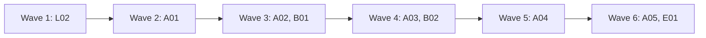

# Plan: finish the connections refactor

This plan finishes the work in [the connections proposal](connections-proposal.md): several AI providers and several Jira accounts, each picked per Pip turn and per agent run. Steps p1 to p6, r7, r8, r9 (#290), r11, the first slice of r12, o10 (#266), j15 to j21, j23 to j25, c0, c1, t1 and t2 are merged, and the Codex decisions are recorded in the proposal (#298). What is left: one open PR (#291, which carries j22), the rest of r12, and r13, r14, j26, j27 and d28. The Codex runner (c3 to c6) moves to a plan of its own. Each entry is one small PR. A PR is done when its acceptance test passes in CI, an adversarial review reports no blockers or majors, and it is squash-merged.

## Goals this release serves

- **Work with the tools you already use**: several Claude logins and several Jira accounts at once, with Codex (beta) shown in Settings. Every entry serves this goal.
- **Agents take a ticket from plan to pull request**: r12b to r14 let a person choose which login and model an agent runs on, and keep runs on a signed-out or removed login from failing silently.
- **Do the day's tracker work in one place**: j26 and j27 show tickets from every Jira account in one Inbox and board.
- Non-goals it comes close to: **no sandbox or agent harness of its own**: agents keep running on the person's own Claude Code setup, now with a choice of login. **No writes to Jira without a draft**: no entry adds a write path.

## Findings

Checked against `main` at a1c7a89 (after #290 and #298) on 3 Nov 2026.

| Finding | Where | What is wrong |
| --- | --- | --- |
| #291 (j22) has an open Gitar bug | `src/claudeStore.ts` (`ask`, `load`, `readWakePrompt`) and, on the #291 branch, `src-tauri/src/agent/mod.rs:428` and `src-tauri/src/inbox/pip_turns.rs` | A turn asked from another site's ticket, or in General while such a ticket is open, is stored under `<connection>:<name>` but the page asks, loads and reads the wake prompt with a bare name, so it vanishes on reload. |
| r12 is half done | `runs/cleanup.rs:112`, `inbox/models.rs:67` | A run whose instance was removed can't be cleaned up; a run on a signed-out login neither waits nor starts when it signs in. The unreviewed WIP commit 383732e on `providers/r12b-runs-record-instance` covers it. |
| Runs only track the default login | `runs/index.rs:23` (`short_id`), `runs/service.rs:101` (`belongs_to`), and 11 non-test `tools.get()` calls. Six act on a run or an instance and need its login: `cleanup.rs:112`, `control.rs:264`, `final_answer.rs:88`, `service.rs:326,657`, `tracker.rs:229`. Five stay on the default on purpose: `service.rs:216` (warm), `service.rs:707` and `service/fresh.rs:95,109` (git keeps the captured environment), `service/choice.rs:24` (a run with no `runs_on`). | The gate at `model_choice.rs:254` keeps agents on the default instance until this is fixed. |
| Provider rows and pickers are hidden | `src/workspace/connectionsLogic.ts:11` (`providersShown = false`) | The backend honours a choice; nothing shows it yet. |
| One Jira in the front end | `src/Root.tsx:24,37,47`, `ConnectJira.tsx:344`, `Workspace.tsx:59`, `Rail.tsx:312` | Adding a second Jira account replaces the first. |
| The proposal keeps Codex out of + Add until the runner | `docs/connections-proposal.md` decision 2, 6.1, the 10.1 table row, and the c3 to c6 notes (#298) | The owner decided Codex shows with a Beta label and is not hidden. With no Codex instance by default (5.2), a Codex row can only exist if + Add offers it. A04 changes this text. |
| Two low QA findings still hold | `src/backend/mockGithub.ts:114`, `ConnectGithub.tsx:88`, `ConnectJira.tsx:71` | The mock says "Checked 3m ago" right after Connect; + Add says "GitHub account" but the sheet says "Connect GitHub". |

## Scope

In:

| Group | Entries | Size |
| --- | --- | --- |
| Open PR | L02 (#291) | S |
| Runs per login | A01 (r12b), A02 (r13a), A03 (r13b), A04 (r14a), A05 (r14b) | M each |
| Several Jira accounts | B01 (j26), B02 (j27) | M each |
| Docs and tidy-up | E01 (d28) | S |

Not in:

| Item | Why it waits |
| --- | --- |
| c2, Pip on Codex | Owner decision, 2 Nov 2026: Pip stays on Claude. Codex keeps built-in tools no flag removes (c0, check C1), which breaks AGENTS.md rule 3. |
| The Codex runner (c3 to c6): agents on Codex | Three plan reviews kept finding design gaps in it (the session handle in the run trait, held `ask` calls, the run folder, the MCP token in `Debug` output). It gets its own plan, built on A02 and A03. Codex still shows in Settings and in + Add with its models (Beta), marked as unable to run anything yet. |
| A switch that hides Codex | Owner decision, 2 Nov 2026: Codex shows like any provider, in Settings and in + Add, with a **Beta** label. |
| Pip starting reviewers for incoming review requests | Not in the goals yet; the maintainer may add it in a goals PR. |
| PRs #269 and #278 | Stale o10 checklist PRs. #278's branch would revert work on main. The maintainer closes both. |

## Order and waves

Two tracks run side by side: runs per login (A) in `src-tauri/src/runs/` and the run views, and Jira (L02, B) in the front end. A01 and A03 both edit `runs/cleanup.rs`, and A02 and A03 both edit `runs/service.rs`, so the A entries form a chain. L02, A01, B01, A04 and A05 all edit `src/backend/mock.ts`, so each sits in its own wave. A04 and B01 both edit `Connections.tsx` and `connectionsLogic.ts`. A04 waits for A03 (wave 5): the proposal keeps provider rows hidden until runs honour their instance (`docs/connections-proposal.md:70`, r14 after r13 at `:573`), and until the gate at `model_choice.rs:254` is lifted, a person could pick `claude_2` for new agents and the backend would refuse it. A03 is Rust only and B02 touches neither `mock.ts` nor the Settings files, so they share wave 4. A05 and E01 follow A04 in wave 6; E01 describes the state after A01 to A05. L02 lands before B01, which builds on j22. The Codex decisions are already on main (#298, formerly entry D01).

## Rules for every PR

- AGENTS.md holds: secrets only in the Keychain and never logged; Pip has only Gossamr's MCP tools; every Tauri command is registered and mirrored in `src/backend/types.ts`, `jira.ts` and the mock; camelCase serde matches TypeScript; schema changes are appended to the right `STEPS`; few comments; test names are behaviour sentences.
- Checks: `pnpm install --frozen-lockfile`, `pnpm typecheck`, `pnpm test`, `pnpm build`, then `mkdir -p dist && cd src-tauri && cargo clippy --all-targets -- -D warnings && cargo test`. Never run `#[ignore]` tests. e2e: `E2E_PORT=<port> pnpm e2e <spec>`; CI runs the full suite in 4 shards.
- Tests never touch the person's real `~/.claude.json`, `~/.claude-personal`, `~/.codex` or Keychain; use temp folders and the fake CLIs in `src-tauri/test-support/`.
- Each PR adds a regression test that fails when the change is removed. The PR description says how that was checked.
- Each negative test checks that its input really contains what the check looks for.
- New e2e tests go in new files, except where an entry names an existing spec.
- After merging `main` into a branch, rerun clippy and the tests locally: two PRs can each pass CI and still break main together (an unused function under `-D warnings`).

## PRs

### Wave 1

**L02 Fix the lost cross-site Pip turns and land #291 (j22).** Touches: `src/claudeStore.ts`, `src/claudeStore.test.ts`, and #291's files: `src-tauri/src/agent/{context.rs,mcp.rs,mod.rs,real_tests.rs,runs.rs,runs/drive_tests.rs,supervisor/tests.rs}`, `src-tauri/src/db/{pip_turns.rs,workstreams.rs}`, `src-tauri/src/inbox.rs`, `src-tauri/src/inbox/{instances.rs,pip_model.rs,pip_scope.rs,pip_turns.rs,workstreams.rs}`, `src/backend/{claude.ts,mock.ts,mockPip.ts,mockPipQueue.ts,mockPipTurns.ts,mockPipTurns.test.ts,mockSeveralJira.test.ts}`, `src/lib/conversations.ts`.
- The page names each conversation with `conversationIn(ticketKey, connectionId)` in `ask`, `load`, `readWakePrompt` and `cancel`, so the turn is stored and read back under the same `<connection>:<name>` key. A bare page name still means the primary connection, so existing conversations keep working. Rust already stores under the qualified key and `pip_conversation` reads one, so the fix is in the page.
- The Pip pane's General conversation is qualified the same way. Rust stores a General question under `<connection>:general`, where the connection is the one the turn runs in, which is the second site when a second-site ticket is open (`agent/mod.rs:428` on the #291 branch). The page names General with the connection of the open ticket, so it reads and cancels what it stored.
- Merge `main` in first: r9's `claudeStore.ts` changes (#290) are already there.
Regression test: vitest cases that `claudeStore.ask` sends the connection-qualified name and that `load` for a second-site ticket reads back the turn `ask` stored. Both fail on the current branch, where `load` uses the bare key. A third vitest case asks in `general` with a second-site ticket open, then loads `general` and gets the turn back. A Rust test checks that a turn stored under `<connection>:<name>` is returned by `pip_conversation` for that key; it passes before and after and guards the Rust half.
Acceptance: `pnpm test claudeStore` and `cargo test pip_turns` pass; Gitar's finding on #291 is answered with the fix.
QA: with `?jira=2`, open a ticket from the second site, ask Pip something, reload, and check the turn is still there. Ask in General with that ticket open and reload. Then do the same on the first site.

### Wave 2

**A01 Finish r12: removed and signed-out logins (r12b).** Touches: `src-tauri/src/runs/{cleanup.rs,repo.rs}`, `src-tauri/src/inbox/{models.rs,provider_probes.rs}`, `src-tauri/src/domain/run.rs`, `src-tauri/src/lib.rs`, `src/backend/{mock.ts,mockProviders.ts,mockRuns.ts}` (the two lines in `mock.ts` wire `MockProviders` into the runs mock, which only `MockBackend` can do), `src/types.ts`, `src/workspace/RunCleanup.tsx`, tests in `runs/cleanup/tests.rs`, `runs/service/choice/tests.rs`, `mockRunSignIn.test.ts`, `cleanup.test.tsx`.
- Start from the WIP commit 383732e on `providers/r12b-runs-record-instance` (unreviewed): merge `main` in, then review it like new code.
- A finished run whose instance was removed is cleaned up with git alone (`git worktree remove` without `--force`, `git branch -d`), and its sheet says the Claude session was left behind (`sessionsLeft`).
- A queued run on a signed-out login waits with "Waits until <name> is signed in", using `model_choice::resolve` with the probe's standing; it starts as soon as the probe sees the login signed in.
Regression test: a cleanup test removes the instance and checks the worktree goes without a Claude call; a launch test with a signed-out probe keeps the run queued, then starts it when the probe turns ready. Both fail on main (`cleanup.rs:112` needs the instance's tools; `agents_target` never waits).
Acceptance: `cargo test cleanup` and `cargo test choice` pass; `pnpm test cleanup mockRunSignIn` pass.

### Wave 3

**A02 Track runs per login (r13a).** Touches: `src-tauri/src/runs/{index.rs,service.rs,tracker.rs}`, `src-tauri/src/runs/service/tests.rs`, `src-tauri/src/runs/tracker/tests.rs`.
- `RunIndex` entries get an `instance_id` (`#[serde(default)]`, reading as the default Claude). Run lookups key on `(instance, short id)`; `belongs_to` uses it.
- `find_session` (`service.rs:326`) and `recover` (`service.rs:657`) ask the daemon with `toolchain_of(run)`: `recover` lists `claude agents` once per instance that has Launching runs.
- The tracker runs `claude agents --json --all` once per instance that has live runs, with that instance's toolchain (`toolchain_of`).
- The gate at `model_choice.rs:254` stays on until A03.
Regression test: one stored run on `claude_2` with short id `abc12345`, and a default-instance listing that also reports `abc12345` (another folder's session); the run follows only `claude_2`'s listing and ignores the default one. The runs table keeps its unique index on `short_id` (`db/schema.rs:449`), so two stored runs never share one; the risk is a foreign listing, not two stored runs. A restart while a run on `claude_2` is Launching recovers it on `claude_2`. Both fail on main, where `belongs_to` matches the short id alone and `recover` asks only the default instance.
Acceptance: `cargo test tracker` and `cargo test recover` pass.

**B01 Add Jira accounts (j26).** Touches: `src/Root.tsx`, `src/accountState.ts`, `src/workspace/{ConnectJira.tsx,Connections.tsx,connectionsLogic.ts,Workspace.tsx,Rail.tsx,commands.ts,commands.test.ts,Palette.tsx}`, `src/backend/{jira.ts,mock.ts,auth.ts,types.ts}`, `src/accountState.test.ts`, `src-tauri/src/auth/{mod.rs,atlassian.rs}`, `src-tauri/src/lib.rs`, `src-tauri/src/inbox.rs`, `src-tauri/src/inbox/{instances.rs,probes.rs}` (a `name` on `TokenSignIn`, mirrored in `auth.ts` and `types.ts`; the `TokenSignIn { .. }` literals at `auth/atlassian.rs:199`, `inbox.rs:1117`, `inbox/instances.rs:1252` and `inbox/probes.rs:268` gain it, and `jira_connect` stores it as the connection's display name), `e2e/{jira-token,connections,first-run}.spec.ts`.
- The desktop backend is chosen whenever any Jira connection that is on exists; the account key no longer depends on one site.
- + Add always offers "Jira account". The sheet is titled "Add Jira account", has a Name field, adds without signing out the first account, and refuses an account that is already connected. Removing the last Jira goes back to Setup; removing another one does not.
- The palette takes its "Add Jira account" entry from `addEntries`, as it does for providers, replacing the `ctx.jira ? [] : add-jira` rule at `commands.ts:142`, so the rule lives in one place.
- After adding, Watching opens for the new account.
Regression test: a cargo test that a second `jira_connect` with a different account and name adds a connection, keeps the first, and stores the name; a vitest test in `accountState.test.ts` for the backend choice with two Jira connections; e2e adds a second account in the mock (`?jira=2` style) and checks both rows stay; a `commands.test.ts` case checks the palette still offers "Add Jira account" once a Jira exists. Fails on main, where the second sign-in replaces the first (`ConnectJira.tsx:344`).
Acceptance: `cargo test jira_connect`, `pnpm test accountState connectionsLogic commands` and `pnpm e2e e2e/connections.spec.ts e2e/jira-token.spec.ts` pass.
QA: add a second Jira account with a different name, check both rows, the Inbox shows tickets from both, remove one, then remove the last and check Setup appears.

### Wave 4

**A03 Every run action uses its own login (r13b).** Touches: `src-tauri/src/runs/{service.rs,answer.rs,message.rs,control.rs,cleanup.rs,final_answer.rs,offer.rs,finder.rs,continuation.rs}`, `src-tauri/src/agent/mod.rs`, `src-tauri/src/model_choice.rs`, tests next to each.
- These become `toolchain_of(run)`: `cleanup.rs:112`, `control.rs:264`, `final_answer.rs:88`, and the actions answer, message, stop, attach, final answer and continuation. `service.rs:326` and `:657` (A02) and `tracker.rs:229` (A02) are already done.
- These stay on the default on purpose: `service.rs:216` (warm), `service.rs:707` and `service/fresh.rs:95,109` (git keeps the captured environment, so it works for a run whose instance is off), and `service/choice.rs:24` (a run with no `runs_on`).
- A message to a run on an instance that is off waits until it is back on (proposal 7.3, 7.4).
- Lift the gate at `model_choice.rs:254`: any Claude instance that is on and signed in can run agents.
Regression test: with two fake CLIs, stopping, answering and messaging a run on `claude_2` call only `claude_2`'s binary and folder; a `model_choice` test accepts `claude_2` for agents. Both fail on main. A trust write on `claude_2` changes only its `.claude.json`; that case already passes on main (`service/trust.rs` uses `toolchain_of`) and guards it against this change.
Acceptance: `cargo test runs::` passes; the gate test fails if the gate is put back.

**B02 Show which Jira account each item comes from (j27).** Touches: `src/workspace/{ItemCard.tsx,ListView.tsx,BoardView.tsx,PeekSheet.tsx,PeekParts.tsx,DraftCard.tsx,FilterBar.tsx,Rail.tsx,PipPane.tsx}`, `src/lib/filter.ts`, `src/claudeStore.ts`, new `src/workspace/ItemCard.test.tsx`, `src/lib/filter.test.ts`, new `e2e/multi-jira.spec.ts`.
- With two or more Jira connections on, cards, rows, the peek and drafts show the connection's name as a chip; with one, nothing changes.
- An Account filter in the filter bar. Rail project groups name the site when two sites share a project key. The ambiguous pull request link (`DevLink.ambiguous`) says which sites could own it.
- Pip's drawer gets a connection control for a conversation with no ticket; it sends `connectionId`.
Regression test: vitest for the chip rule (one connection, none; two, shown) and the Account filter; `e2e/multi-jira.spec.ts` with `?jira=2`. Fails on main, which has no chip or filter.
Acceptance: `pnpm test filter ItemCard` and `pnpm e2e e2e/multi-jira.spec.ts` pass.
QA: with `?jira=2`, filter by each account, open a ticket from each, and check the chip and Rail labels in light and dark.

### Wave 5

**A04 Settings and provider pickers, provider rows shown (r14a).** Touches: `src/workspace/{Settings.tsx,Connections.tsx,connectionsLogic.ts,connectionsLogic.test.ts}`, `src/components/ModelPicker.tsx` (reuse only), `src/backend/mock.ts`, `e2e/providers.spec.ts`, `docs/connections-proposal.md`. Starts after A03 is merged; rerun its e2e after merging `main`.
- `providersShown` becomes true: Claude and Codex rows show under Models.
- Settings gets a Models section: "Pip uses" and "New agents use", each a `ModelPicker`. The provider detail gets its own models with "Add model…". Safety's second promise names the instance.
- A Codex row, sheet and picker entry carry a **Beta** label (owner decision, #298). `addEntries` offers Codex whenever providers show, and the `?codex=1` switch and `DRIVER_CAPABILITIES.codex.runsAgents` check in `connectionsLogic.ts:20,40,57` go. The proposal's decision 2, 6.1 ("+ Add lists only drivers that can run something"), the 10.1 table row ("Shown from c6") and the c3 to c6 notes change to say + Add offers Codex from r14a with Beta, marked as unable to run anything yet. The palette takes its entries from `addEntries`, so Codex appears there too.
- A Codex instance is greyed in both pickers with the 7.1 reason ("Agents can't run on Codex yet", "Pip can't run on Codex yet").
Regression test: vitest for the defaults written by each picker; e2e changes "New agents use" and checks a new run starts on it in the mock. A vitest case checks that `addEntries` lists Codex with Beta without `?codex=1`, and an e2e case checks Codex is greyed in "New agents use". Fails on main, where the rows are hidden and + Add omits Codex.
Acceptance: `pnpm test Settings connectionsLogic` and `pnpm e2e e2e/providers.spec.ts` pass.
QA: add a second Claude, set it as "New agents use", start an agent and check its card; check the Beta label on Codex in light and dark.

### Wave 6

**A05 Run and workstream pickers (r14b).** Touches: `src/workspace/{RunSheet.tsx,AgentParts.tsx,RunCleanup.tsx,failureHelp.ts,WorkstreamControls.tsx,WorkstreamSheet.tsx,workstreamsStore.ts,SignInBanner.tsx}`, `src/backend/{mockRuns.ts,mock.ts}`, new `src/workspace/AgentParts.test.tsx`, `src/workspace/failureHelp.test.ts`, `e2e/agents-and-runs.spec.ts`, `e2e/workstreams.spec.ts`.
- A queued run's card and sheet say "Runs on <instance> · <model>" with Change; a started run says "Ran on". The workstream sheet has "New agents use".
- Failure help and the signed-out banner name the instance and its sign-in command.
Regression test: vitest for the Runs on / Ran on text; e2e changes a queued run's model and checks it starts on the new one. Fails on main, which has no Change.
Acceptance: `pnpm test AgentParts failureHelp` and `pnpm e2e e2e/agents-and-runs.spec.ts e2e/workstreams.spec.ts` pass.
QA: queue a run, change its model, let it start; sign the second Claude out in the mock and check the banner and the waiting run.

**E01 Docs and tidy-up (d28).** Touches: `AGENTS.md`, `README.md`, `docs/agents-cli-findings.md`, `src/backend/mockGithub.ts`, `src/backend/mockGithub.test.ts`, `src/workspace/ConnectGithub.tsx`, new `src/workspace/ConnectGithub.test.tsx` (the sheet title).
- AGENTS.md per proposal section 12 (d28): the Read-first list (`docs/connections-proposal.md`, `docs/goals.md`) and rules 2 and 4 as they stand after A01 to A05: several Claude config folders, each agent run on its own instance's login. The Codex rows of the layout table and rules wait for the Codex runner's plan.
- README: adding a second Claude and a second Jira account, and Codex (beta): can be added in + Add and shows in Settings with its models, not yet able to run agents.
- Findings: one daemon per config folder, with the o10 result.
- The mock sets `checkedAt` on Connect, so a new GitHub row says "Checked just now". The GitHub sheet is titled "Add GitHub account", matching + Add.
Regression test: a vitest test that a just-connected mock GitHub reports a fresh check; fails on main (`mockGithub.ts:114` sets it once).
Acceptance: `pnpm test mockGithub ConnectGithub` passes.

## Flagged concerns

- The runs track is a chain of five PRs (A01 to A05). The Codex runner waits for its own plan; A02 and A03 give it per-instance tracking to build on.
- `docs/plan-*.md`, `AGENTS.md` and lockfiles are gated paths: the maintainer merges those PRs. The maintainer asked for every PR of this refactor to be merged once CI is green and a review bot clears it.
- A01 starts from an unreviewed WIP commit. If its review finds the approach wrong, rebuild it from main.
