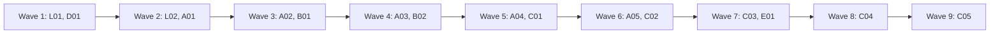

# Plan: finish the connections refactor

This plan finishes the work in [the connections proposal](connections-proposal.md): several AI providers and several Jira accounts, each picked per Pip turn and per agent run. Steps p1 to p6, r7, r8, r11, the first slice of r12, j15 to j21, j23 to j25, c0, c1, t1 and t2 are merged. What is left: two open PRs (#290, and #291 which carries j22), the rest of r12, and r13, r14, j26, j27, d28 and c3 to c6. Each entry is one small PR. A PR is done when its acceptance test passes in CI, an adversarial review reports no blockers or majors, and it is squash-merged.

## Goals this release serves

- **Work with the tools you already use**: several Claude logins, Codex (beta) and several Jira accounts at once. Every entry serves this goal.
- **Agents take a ticket from plan to pull request**: r12b to r14 let a person choose which login and model an agent runs on, and keep runs on a signed-out or removed login from failing silently.
- **Do the day's tracker work in one place**: j26 and j27 show tickets from every Jira account in one Inbox and board.
- Non-goals it comes close to: **no sandbox or agent harness of its own**. The Codex runner (c3 to c6) drives the person's own `codex` CLI with their own config; it adds no sandbox, and it passes no `--sandbox` flag (owner decision, see D01). **No writes to Jira without a draft**: no entry adds a write path.

## Findings

Checked against `main` at 2d3dd4e on 2 Nov 2026.

| Finding | Where | What is wrong |
| --- | --- | --- |
| #290 (r9) conflicts with main | `src/backend/mock.ts`, `mockWatch.ts`, `src/workspace/connectionsLogic.ts` | #292 changed the same lines. CI and Gitar passed before that. |
| #291 (j22) has an open Gitar bug | `src/claudeStore.ts` (`ask`, `load`, `readWakePrompt`) and, on the #291 branch, `src-tauri/src/agent/mod.rs:428` and `src-tauri/src/inbox/pip_turns.rs` | A turn asked from another site's ticket is stored under `<connection>:<name>` but the page asks, loads and reads the wake prompt with a bare name, so it vanishes on reload. |
| r12 is half done | `runs/cleanup.rs:112`, `inbox/models.rs:67` | A run whose instance was removed can't be cleaned up; a run on a signed-out login neither waits nor starts when it signs in. The unreviewed WIP commit 383732e on `providers/r12b-runs-record-instance` covers it. |
| Runs only track the default login | `runs/index.rs:23` (`short_id`), `runs/service.rs:101` (`belongs_to`), and 11 non-test `tools.get()` calls: `cleanup.rs:112`, `control.rs:264`, `final_answer.rs:88`, `service.rs:216,326,657,707`, `service/choice.rs:24`, `service/fresh.rs:95,109`, `tracker.rs:229` | The gate at `model_choice.rs:254` keeps agents on the default instance until this is fixed. |
| Provider rows and pickers are hidden | `src/workspace/connectionsLogic.ts:11` (`providersShown = false`) | The backend honours a choice; nothing shows it yet. |
| One Jira in the front end | `src/Root.tsx:24,37,47`, `ConnectJira.tsx:344`, `Workspace.tsx:59`, `Rail.tsx:312` | Adding a second Jira account replaces the first. |
| The proposal does not record the Codex decisions | `docs/connections-proposal.md:135,364,532,590`, `docs/agents-cli-findings.md` | c2 still reads "only if c0 says yes"; the sandbox row says "owner to confirm"; no doc says Codex is beta. |
| Two low QA findings still hold | `src/backend/mockGithub.ts:114`, `ConnectGithub.tsx:88`, `ConnectJira.tsx:71` | The mock says "Checked 3m ago" right after Connect; + Add says "GitHub account" but the sheet says "Connect GitHub". |

## Scope

In:

| Group | Entries | Size |
| --- | --- | --- |
| Open PRs | L01 (#290), L02 (#291) | S each |
| Decisions in the docs | D01 | S |
| Runs per login | A01 (r12b), A02 (r13a), A03 (r13b), A04 (r14a), A05 (r14b) | M each |
| Several Jira accounts | B01 (j26), B02 (j27) | M each |
| Codex runner (beta) | C01 (c3), C02 (c4a), C03 (c4b), C04 (c5), C05 (c6) | M each |
| Docs and tidy-up | E01 (d28) | S |

Not in:

| Item | Why it waits |
| --- | --- |
| c2, Pip on Codex | Owner decision, 2 Nov 2026: Pip stays on Claude. Codex keeps built-in tools no flag removes (c0, check C1), which breaks AGENTS.md rule 3. |
| A switch that hides Codex | Owner decision, 2 Nov 2026: Codex shows like any provider, with a **Beta** label. |
| Pip starting reviewers for incoming review requests | Not in the goals yet; the maintainer may add it in a goals PR. |
| PRs #269 and #278 | Stale o10 checklist PRs. #278's branch would revert work on main. The maintainer closes both. |

## Order and waves

Two tracks run side by side: runs and Codex (A, C) in `src-tauri/src/runs/`, and Jira (L02, B) in the front end. The runs and Codex track is a chain: A01 and A03 both edit `runs/cleanup.rs`; A02, A03, C01 to C04 edit `runs/{tracker,cli,toolchain,index,control}.rs`. A04, B01 and C05 edit `src/workspace/Connections.tsx` and `connectionsLogic.ts`, and A05 and C05 both edit `failureHelp.ts`, so they sit in different waves. L01 lands before L02 (wave 1, then wave 2), because both touch `src/backend/mock.ts` and `mockPip.ts`, and before A04, which reuses its `ModelPicker`. L02 lands before B01, which also edits `mock.ts` and builds on j22. A01 keeps its mock changes in `mockRuns.ts` and `mockProviders.ts`, so it shares no file with L01 or L02. D01 changes docs only and goes in wave 1 so later entries read the decisions.

## Rules for every PR

- AGENTS.md holds: secrets only in the Keychain and never logged; Pip has only Gossamr's MCP tools; every Tauri command is registered and mirrored in `src/backend/types.ts`, `jira.ts` and the mock; camelCase serde matches TypeScript; schema changes are appended to the right `STEPS`; few comments; test names are behaviour sentences.
- Checks: `pnpm install --frozen-lockfile`, `pnpm typecheck`, `pnpm test`, `pnpm build`, then `mkdir -p dist && cd src-tauri && cargo clippy --all-targets -- -D warnings && cargo test`. Never run `#[ignore]` tests. e2e: `E2E_PORT=<port> pnpm e2e <spec>`; CI runs the full suite in 4 shards.
- Tests never touch the person's real `~/.claude.json`, `~/.claude-personal`, `~/.codex` or Keychain; use temp folders and the fake CLIs in `src-tauri/test-support/`.
- Each PR adds a regression test that fails when the change is removed. The PR description says how that was checked.
- Each negative test checks that its input really contains what the check looks for.
- New e2e tests go in new files, except where an entry names an existing spec.
- After merging `main` into a branch, rerun clippy and the tests locally: two PRs can each pass CI and still break main together (an unused function under `-D warnings`).

## PRs

### Wave 1

**L01 Land the model picker in Pip's drawer (#290, r9).** Touches: `src/backend/mock.ts`, `src/backend/mockWatch.ts`, `src/workspace/connectionsLogic.ts` (conflict resolution only).
- Merge `main` into `providers/r9-pip-model-picker` and keep both sides. r9 brought `providers.addClaude` (`mock.ts`, `mockWatch.ts`) and the `providersVisible` export (`connectionsLogic.ts`). #292, now on main, brought `revealedFolders` (`mock.ts`, `mockWatch.ts`, including the `exposeMockClock` signature, which takes both) and `codexAsked` (`connectionsLogic.ts`).
- No new behaviour. CI, Gitar and the bot answers were done before the conflict.
Regression test: a new `providersVisible()` case in the existing `connectionsLogic.test.ts`, plus the existing `ModelPicker.test.tsx`, `modelPicker.test.ts`, `claudeStore.test.ts` and the r9 block in `e2e/pip.spec.ts` still pass after the merge.
Acceptance: CI green on the merged head. The PR adds an assertion on `providersVisible()` to `src/workspace/connectionsLogic.test.ts` (no test mentions it today), and `pnpm test` fails if the merge drops it, `codexAsked` or `revealedFolders`. `codexAsked` is covered only by `e2e/providers.spec.ts` (through `?codex=1`), so the PR runs that spec too; it names the tests that use `revealedFolders` and checks each by deleting the export.

**D01 Record the Codex decisions in the docs.** Touches: `docs/connections-proposal.md`, `docs/agents-cli-findings.md`.
- c2 is skipped by owner decision on 2 Nov 2026 (Pip stays on Claude): update section 1 (line 19), decision 2 (line 63, "For the owner to confirm"), the 6.1 table (line 135), the c0 row (line 362), lines 364, 532, 590 and 598, and the risk at line 666.
- Codex agents get no `--sandbox` flag, so the person's own Codex config decides (owner decision, 2 Nov 2026); mark the findings row confirmed and say what `workspace-write` breaks (C6).
- Codex is a beta provider: a **Beta** label on its row, its sheet and its picker entries, and nothing hidden behind a switch. Add this to 8.x, 10.x and the c6 step.
- Steps p1 to p6, r7, r8, r11, j15 to j21, j23 to j25, c0, c1, t1 and t2 are marked merged with their PR numbers. j22 stays open until L02 lands.
Regression test: none (docs only).
Acceptance: `grep -n "if c0 says yes" docs/connections-proposal.md` finds nothing, decision 2 no longer says "For the owner to confirm", and the Beta rule and both decisions appear with their date.

### Wave 2

**L02 Fix the lost cross-site Pip turns and land #291 (j22).** Touches: `src/claudeStore.ts`, `src/claudeStore.test.ts`, and #291's files: `src-tauri/src/agent/{context.rs,mcp.rs,mod.rs,real_tests.rs,runs.rs,runs/drive_tests.rs,supervisor/tests.rs}`, `src-tauri/src/db/{pip_turns.rs,workstreams.rs}`, `src-tauri/src/inbox.rs`, `src-tauri/src/inbox/{instances.rs,pip_model.rs,pip_scope.rs,pip_turns.rs,workstreams.rs}`, `src/backend/{claude.ts,mock.ts,mockPip.ts,mockPipQueue.ts,mockPipTurns.ts,mockPipTurns.test.ts,mockSeveralJira.test.ts}`, `src/lib/conversations.ts`.
- The page names each conversation with `conversationIn(ticketKey, connectionId)` in `ask`, `load`, `readWakePrompt` and `cancel`, so the turn is stored and read back under the same `<connection>:<name>` key. A bare page name still means the primary connection, so existing conversations keep working. Rust already stores under the qualified key and `pip_conversation` reads one, so the fix is in the page.
- Merge `main` in after L01 lands (wave 2).
Regression test: vitest cases that `claudeStore.ask` sends the connection-qualified name and that `load` for a second-site ticket reads back the turn `ask` stored. Both fail on the current branch, where `load` uses the bare key. A Rust test checks that a turn stored under `<connection>:<name>` is returned by `pip_conversation` for that key; it passes before and after and guards the Rust half.
Acceptance: `pnpm test claudeStore` and `cargo test pip_turns` pass; Gitar's finding on #291 is answered with the fix.
QA: with `?jira=2`, open a ticket from the second site, ask Pip something, reload, and check the turn is still there; then do the same on the first site.

**A01 Finish r12: removed and signed-out logins (r12b).** Touches: `src-tauri/src/runs/{cleanup.rs,repo.rs}`, `src-tauri/src/inbox/{models.rs,provider_probes.rs}`, `src-tauri/src/domain/run.rs`, `src-tauri/src/lib.rs`, `src/backend/{mockProviders.ts,mockRuns.ts}` (not `mock.ts`: the two-line change in 383732e moves into `mockRuns.ts`), `src/types.ts`, `src/workspace/RunCleanup.tsx`, tests in `runs/cleanup/tests.rs`, `runs/service/choice/tests.rs`, `mockRunSignIn.test.ts`, `cleanup.test.tsx`.
- Start from the WIP commit 383732e on `providers/r12b-runs-record-instance` (unreviewed): merge `main` in, then review it like new code.
- A finished run whose instance was removed is cleaned up with git alone (`git worktree remove` without `--force`, `git branch -d`), and its sheet says the Claude session was left behind (`sessionsLeft`).
- A queued run on a signed-out login waits with "Waits until <name> is signed in", using `model_choice::resolve` with the probe's standing; it starts as soon as the probe sees the login signed in.
Regression test: a cleanup test removes the instance and checks the worktree goes without a Claude call; a launch test with a signed-out probe keeps the run queued, then starts it when the probe turns ready. Both fail on main (`cleanup.rs:112` needs the instance's tools; `agents_target` never waits).
Acceptance: `cargo test cleanup` and `cargo test choice` pass; `pnpm test cleanup mockRunSignIn` pass.

### Wave 3

**A02 Track runs per login (r13a).** Touches: `src-tauri/src/runs/{index.rs,service.rs,tracker.rs}`, `src-tauri/src/runs/service/tests.rs`, `src-tauri/src/runs/tracker/tests.rs`.
- `RunIndex` entries get an `instance_id` (`#[serde(default)]`, reading as the default Claude). Run lookups key on `(instance, short id)`; `belongs_to` and `recover` use it.
- The tracker runs `claude agents --json --all` once per instance that has live runs, with that instance's toolchain (`toolchain_of`).
- The gate at `model_choice.rs:254` stays on until A03.
Regression test: two fake CLIs that both report short id `abc12345`; each run follows only its own instance's listing. A restart while a run on `claude_2` is Launching recovers it on `claude_2`. Fails on main, where `belongs_to` matches the short id alone.
Acceptance: `cargo test tracker` and `cargo test recover` pass.

**B01 Add Jira accounts (j26).** Touches: `src/Root.tsx`, `src/accountState.ts`, `src/workspace/{ConnectJira.tsx,Connections.tsx,connectionsLogic.ts,Workspace.tsx,Rail.tsx}`, `src/backend/{jira.ts,mock.ts,auth.ts,types.ts}`, `src-tauri/src/auth/mod.rs` and `src-tauri/src/lib.rs` (a `name` on `TokenSignIn`, mirrored in `auth.ts` and `types.ts`), `e2e/{jira-token,connections,first-run}.spec.ts`.
- The desktop backend is chosen whenever any Jira connection that is on exists; the account key no longer depends on one site.
- + Add always offers "Jira account". The sheet is titled "Add Jira account", has a Name field, adds without signing out the first account, and refuses an account that is already connected. Removing the last Jira goes back to Setup; removing another one does not.
- After adding, Watching opens for the new account.
Regression test: a vitest test for the backend choice with two Jira connections; e2e adds a second account in the mock (`?jira=2` style) and checks both rows stay. Fails on main, where the second sign-in replaces the first (`ConnectJira.tsx:344`).
Acceptance: `pnpm test Root connectionsLogic` and `pnpm e2e e2e/connections.spec.ts e2e/jira-token.spec.ts` pass.
QA: add a second Jira account with a different name, check both rows, the Inbox shows tickets from both, remove one, then remove the last and check Setup appears.

### Wave 4

**A03 Every run action uses its own login (r13b).** Touches: `src-tauri/src/runs/{service.rs,answer.rs,message.rs,control.rs,cleanup.rs,final_answer.rs,offer.rs,finder.rs,continuation.rs}`, `src-tauri/src/agent/mod.rs`, `src-tauri/src/model_choice.rs`, tests next to each.
- Every `self.tools.get()` that acts on a run becomes `toolchain_of(run)`, including `service.rs:216,326,657,707`; `service/choice.rs:24` and `service/fresh.rs` keep the default on purpose: answer, message, stop, attach, clean-up, final answer, offers, `unready`, `sweep_agent_files`, `disk`, `short_ids`.
- A message to a run on an instance that is off waits until it is back on (proposal 7.3, 7.4).
- Lift the gate at `model_choice.rs:254`: any Claude instance that is on and signed in can run agents.
Regression test: with two fake CLIs, stopping, answering and messaging a run on `claude_2` call only `claude_2`'s binary and folder; a trust write on `claude_2` changes only its `.claude.json`. A `model_choice` test accepts `claude_2` for agents. All fail on main.
Acceptance: `cargo test runs::` passes; the gate test fails if the gate is put back.

**B02 Show which Jira account each item comes from (j27).** Touches: `src/workspace/{ItemCard.tsx,ListView.tsx,BoardView.tsx,PeekSheet.tsx,PeekParts.tsx,DraftCard.tsx,FilterBar.tsx,Rail.tsx,PipPane.tsx}`, `src/lib/filter.ts`, `src/claudeStore.ts`, new `e2e/multi-jira.spec.ts`.
- With two or more Jira connections on, cards, rows, the peek and drafts show the connection's name as a chip; with one, nothing changes.
- An Account filter in the filter bar. Rail project groups name the site when two sites share a project key. The ambiguous pull request link (`DevLink.ambiguous`) says which sites could own it.
- Pip's drawer gets a connection control for a conversation with no ticket; it sends `connectionId`.
Regression test: vitest for the chip rule (one connection, none; two, shown) and the Account filter; `e2e/multi-jira.spec.ts` with `?jira=2`. Fails on main, which has no chip or filter.
Acceptance: `pnpm test filter ItemCard` and `pnpm e2e e2e/multi-jira.spec.ts` pass.
QA: with `?jira=2`, filter by each account, open a ticket from each, and check the chip and Rail labels in light and dark.

### Wave 5

**A04 Settings and provider pickers, provider rows shown (r14a).** Touches: `src/workspace/{Settings.tsx,Connections.tsx,connectionsLogic.ts}`, `src/components/ModelPicker.tsx` (reuse only), `src/backend/mock.ts`, `e2e/providers.spec.ts`.
- `providersShown` becomes true: Claude and Codex rows show under Models.
- Settings gets a Models section: "Pip uses" and "New agents use", each a `ModelPicker`. The provider detail gets its own models with "Add model…". Safety's second promise names the instance.
- A Codex row, sheet and picker entry carry a **Beta** label (D01).
Regression test: vitest for the defaults written by each picker; e2e changes "New agents use" and checks a new run starts on it in the mock. Fails on main, where the rows are hidden.
Acceptance: `pnpm test Settings connectionsLogic` and `pnpm e2e e2e/providers.spec.ts` pass.
QA: add a second Claude, set it as "New agents use", start an agent and check its card; check the Beta label on Codex in light and dark.

**C01 A run backend trait (c3).** Touches: `src-tauri/src/runs/{cli.rs,toolchain.rs,control.rs,cleanup.rs,answer.rs,message.rs,final_answer.rs,continuation.rs,service.rs,testing.rs,real_tests.rs}`, `src-tauri/src/runs/service/tests.rs`.
- Add a run backend trait above `ClaudeCli` (which `Toolchain.cli` already holds as `Arc<dyn ClaudeCli>`, `toolchain.rs:19`), as proposal c3 says: launch, observe, stop, interrupt-then-resume, final answer, attach, clean-up (session removal) and sign-in commands. Claude implements it with the existing code.
- Its methods take a backend-neutral session handle (a Claude short id, or a Codex thread id plus pid) instead of a `ShortId`. The `short_id` and `earlier_sessions` checks in cleanup, control, answer, message, final_answer, continuation and `recover` (`service.rs:646`) move behind the handle, so a run with no Claude short id is not refused before the backend is asked.
- No behaviour change.
Regression test: the existing runs tests pass unchanged against the trait; one new test calls every trait method on the Claude backend through `dyn`. A refactor test that would fail if a method silently fell back to the default instance.
Acceptance: `cargo test runs::` passes with no test edited except type names.

### Wave 6

**A05 Run and workstream pickers (r14b).** Touches: `src/workspace/{RunSheet.tsx,AgentParts.tsx,RunCleanup.tsx,failureHelp.ts,WorkstreamControls.tsx,SignInBanner.tsx}`, `src/backend/{mockRuns.ts,mock.ts}`, `e2e/agents-and-runs.spec.ts`, `e2e/workstreams.spec.ts`.
- A queued run's card and sheet say "Runs on <instance> · <model>" with Change; a started run says "Ran on". The workstream sheet has "New agents use".
- Failure help and the signed-out banner name the instance and its sign-in command.
Regression test: vitest for the Runs on / Ran on text; e2e changes a queued run's model and checks it starts on the new one. Fails on main, which has no Change.
Acceptance: `pnpm test AgentParts failureHelp` and `pnpm e2e e2e/agents-and-runs.spec.ts e2e/workstreams.spec.ts` pass.
QA: queue a run, change its model, let it start; sign the second Claude out in the mock and check the banner and the waiting run.

**C02 Codex launch (c4a).** Touches: new `src-tauri/src/runs/codex/{mod.rs,launch.rs}`, `src-tauri/src/runs/{toolchain.rs,launcher.rs,index.rs,service.rs}`, `src-tauri/src/domain/run.rs`, `src-tauri/src/db/{schema.rs,runs.rs}`, a fake `codex` in `src-tauri/test-support/`.
- A Codex backend makes the worktree and branch and runs `codex exec --json -C <worktree> -o <run folder>/final.txt` with stdin closed, in its own session so it outlives Gossamr, with stdout to `events.jsonl` in the run folder. It passes no `--sandbox` flag.
- It gives the agent Gossamr's MCP server and guard per run through `-c`: `mcp_servers.gossamr.*` with `bearer_token_env_var="GOSSAMR_MCP_TOKEN"` (the token is in the child's environment, never in argv) and `default_tools_approval_mode="approve"` (c0 check C2), plus the agent guard in `developer_instructions` (C3), and a per-tool timeout on the Gossamr server above how long `ask` waits (Claude's is `AGENT_CALL_TIMEOUT_MS`, 600 s, `runs/agent_config.rs:61`). c0 did not test a held call, so the builder confirms the real Codex key name (`tool_timeout_sec` is expected) against the CLI's own help or source and records it in `docs/agents-cli-findings.md`.
- It stores the Codex thread id in `Run.session_id` (`domain/run.rs:487`) and takes the instance from `runs_on`. One appended `APP_STEPS` column holds the pid, and the `RunIndex` entry gets an optional pid beside `short_id`, keyed by instance as in A02.
- `SystemToolchain::build` (`toolchain.rs:90`) picks the backend by the instance's driver, so a Codex instance gets the Codex backend; `for_instance` keeps refusing a driver whose `runs_agents` is false (`toolchain.rs:120`), so Codex still can't be chosen for agents until C05. `launcher.rs` and `service.rs` change only to call the trait.
Regression test: with the fake codex, a launch writes `events.jsonl`, records the thread id in `session_id` and the pid, and leaves the process running after the launcher returns. The arguments carry the MCP server, approval mode, tool timeout, guard and `-o`, and the token is in the environment only. Fails on main, which has no Codex backend.
Acceptance: `cargo test codex` passes; a test fails if `--sandbox` appears in the arguments, the token appears in argv, or the tool timeout is missing; `grep -n "Driver::Codex" src-tauri/src/runs/{launcher,service}.rs` finds nothing.

### Wave 7

**C03 Codex supervision (c4b).** Touches: `src-tauri/src/runs/codex/{events.rs,recover.rs}`, `src-tauri/src/runs/{tracker.rs,service.rs}`, tests.
- Map Codex events to working, done and failed. "Needs answer" comes from `core.asks()`, as it does for Claude runs (`runs/ask.rs`, `tracker.rs:471`), not from the event stream, so there is one source for a pending question. After a restart, `recover` (`service.rs:646`) finds a Codex run again by pid and `events.jsonl`.
- This lives in `runs/codex/` as trait methods (C01); `tracker.rs` changes only to call the trait.
Regression test: fixture event streams for each state; a restart test with a live fake process and one that has exited. Fails on main.
Acceptance: `cargo test codex` passes.

**E01 Docs and tidy-up (d28).** Touches: `AGENTS.md`, `README.md`, `docs/agents-cli-findings.md`, `src/backend/mockGithub.ts`, `src/workspace/ConnectGithub.tsx`, their tests.
- AGENTS.md per proposal section 12 (d28): the layout table (a `runs/codex/` row beside `claude --bg --worktree`), the Read-first list (`docs/connections-proposal.md`, `docs/goals.md`), and rules 2 and 4: rule 2 says a Codex agent gets its per-run token through `GOSSAMR_MCP_TOKEN` in its environment, never in argv, and that the token stops working when the run ends; rule 4 says Codex agents get no `--sandbox` flag and names the test that guards it (C02).
- README: adding a second Claude and a second Jira account. C05 adds Codex (beta) once it can run agents.
- Findings: one daemon per config folder, with the o10 result.
- The mock sets `checkedAt` on Connect, so a new GitHub row says "Checked just now". The GitHub sheet is titled "Add GitHub account", matching + Add.
Regression test: a vitest test that a just-connected mock GitHub reports a fresh check; fails on main (`mockGithub.ts:114` sets it once).
Acceptance: `pnpm test mockGithub ConnectGithub` passes.

### Wave 8

**C04 Codex answer, resume, stop and clean-up (c5).** Touches: `src-tauri/src/runs/codex/control.rs`, `src-tauri/src/runs/{answer.rs,message.rs,control.rs,cleanup.rs}`, tests.
- Answer and message: SIGINT the running `exec`, then `codex exec resume <thread> --json` with no sandbox flags (c0 check C5), passing the same MCP, approval, tool timeout, guard and `-o` keys as C02. Stop: SIGINT, then SIGKILL after a wait. Clean-up removes the worktree with git (A01's `Git::remove_worktree`) and deletes the Codex session with `codex delete --force <uuid>`.
- All of it is trait methods in `runs/codex/`; `answer.rs`, `message.rs`, `control.rs` and `cleanup.rs` change only to call the trait.
Regression test: with the fake codex, a message resumes the same thread id with the earlier context; stop leaves no process; clean-up leaves no worktree. Fails on main.
Acceptance: `cargo test codex` passes; `grep -n "Driver::Codex" src-tauri/src/runs/{answer,message,control,cleanup}.rs` finds nothing.

### Wave 9

**C05 Codex final answer, Terminal and UI (c6).** Touches: `src-tauri/src/runs/{final_answer.rs,control.rs}`, `src-tauri/src/connections.rs`, `src-tauri/src/model_choice.rs`, `src/workspace/{failureHelp.ts,connectionsLogic.ts,Connections.tsx}`, `README.md`.
- The final answer is read from the `-o` file that C02 and C04 already pass. Attach stops the `exec` first, then opens `codex resume` in Terminal.
- `Driver::runs_agents` and `DRIVER_CAPABILITIES.codex.runsAgents` turn on, so + Add offers Codex and agents can run on it; the **Beta** label stays.
- Failure help for Codex sign-in and a missing CLI.
Regression test: an e2e run on a Codex instance in the mock ends with its final answer; a Rust test reads the `-o` file. Fail on main, where Codex can't run agents.
Acceptance: `cargo test codex` and `pnpm e2e e2e/providers.spec.ts` pass.
QA: add Codex (Beta), start an agent on it in the mock, attach, and read its final answer.

## Flagged concerns

- The runs and Codex track is a chain of eight PRs. If time runs short, waves 7 to 9 (Codex supervision onwards) can wait; the Claude and Jira work stands without them.
- `docs/plan-*.md`, `AGENTS.md` and lockfiles are gated paths: the maintainer merges those PRs. The maintainer asked for every PR of this refactor to be merged once CI is green and a review bot clears it.
- A01 starts from an unreviewed WIP commit. If its review finds the approach wrong, rebuild it from main.
